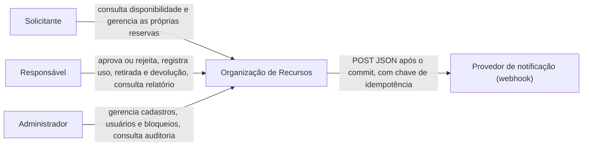
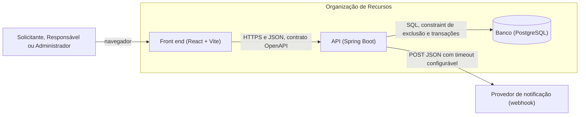
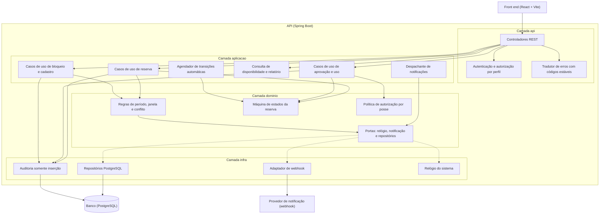
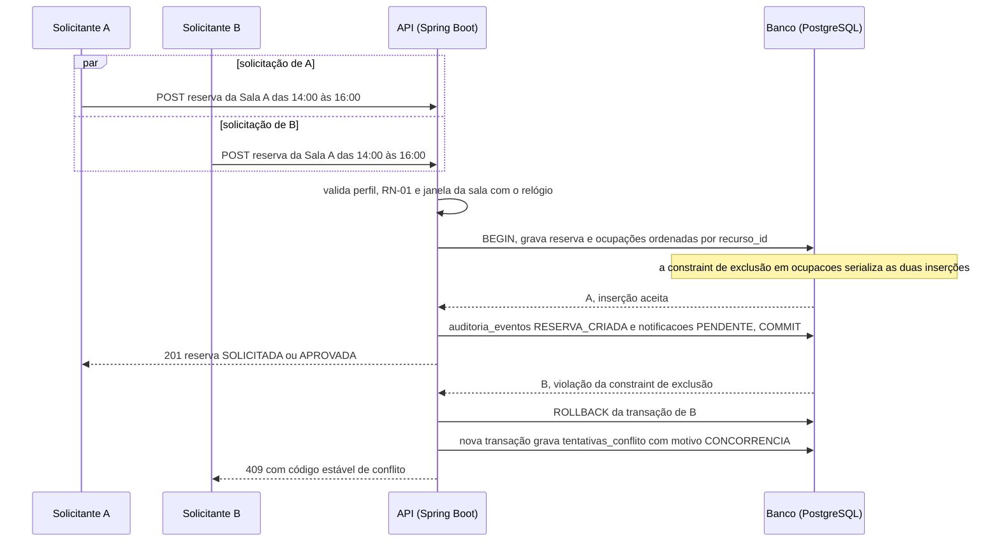
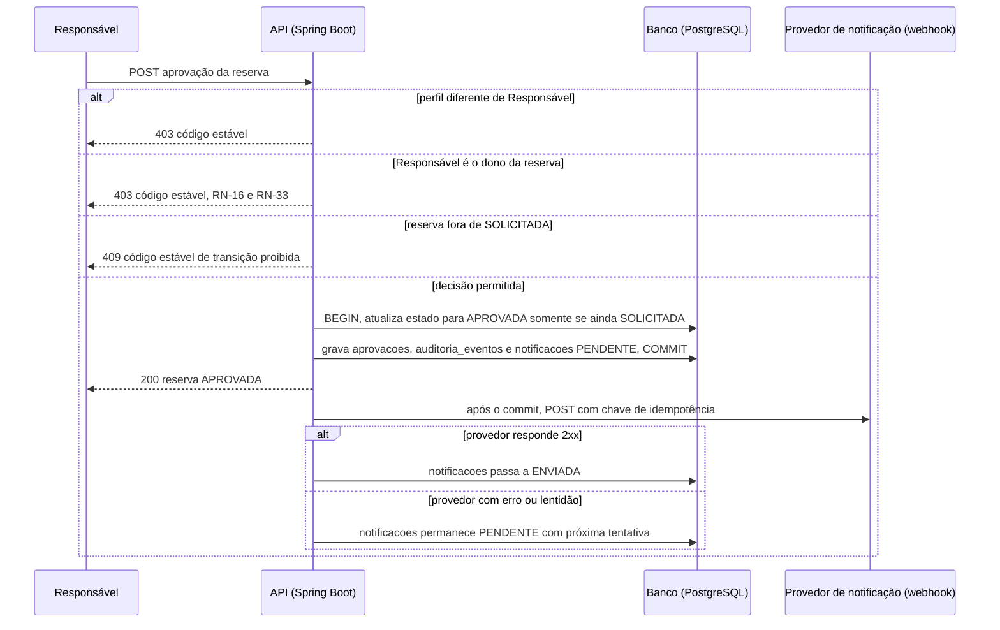

# Arquitetura — Organização de Recursos

| Campo | Valor |
| --- | --- |
| Projeto | Organização de Recursos (Qualidade de Software, TADS, 2026.2) |
| Documento | Descoberta, drivers e arquitetura C4 (Prompts 2.1 e 2.2 da Fase 2) |
| Estado | Rascunho de 15/10/2026. ATAM e ADR entram nos Prompts 2.3 e 2.4 |
| Fonte de verdade | [Especificação do projeto](https://afonsolelis.github.io/aulas_senac/pages/qualidade2/especificacao-projeto.html), lida em 12/10/2026 |
| Responsável | Equipe. Nomes: TODO |

Este documento só consome artefatos do repositório, citados em cada seção: [prd.md](prd.md), [perguntas-abertas.md](prd/perguntas-abertas.md), [regras-negocio.md](prd/regras-negocio.md), [requisitos-funcionais.md](prd/requisitos-funcionais.md), [modelo-dados.dbml](prd/modelo-dados.dbml), [fluxos-sequencia.md](prd/fluxos-sequencia.md), [plano-de-teste.md](plano-de-teste.md) e [RTM.md](../RTM.md). Nenhum requisito, persona ou regra é criado ou alterado aqui. Os identificadores existentes são preservados.

Classificação usada em todo o documento, igual à de [perguntas-abertas.md](prd/perguntas-abertas.md):

| Marca | Significado |
| --- | --- |
| **Fato** | Está na especificação ou em artefato versionado, com a origem citada |
| **Decisão** | Escolha da equipe com ID (A1 a D8) ou proposta de arquitetura ainda a decidir nos Prompts 2.2 e 2.4 |
| **Suposição** | Premissa sem confirmação, com impacto se estiver errada |
| **Lacuna** | Ponto sem definição na fonte; nenhum valor é assumido |

## 1. Contexto e objetivo

**Fato** ([prd.md](prd.md), seção 1): o sistema aloca **salas, professores e materiais** sem conflito de horário. O foco da avaliação é apresentar evidências objetivas de qualidade, segurança, rastreabilidade e desempenho, e não apenas que o sistema funcione.

**Fato** ([prd.md](prd.md), seção 4.3): a stack exigida é Java 21 e Spring Boot 3.x. **Decisão da equipe** ([prd.md](prd.md), seção 4.5): Maven, PostgreSQL e front end React + Vite como SPA que consome a API REST. Os dois últimos aguardam ADR na Fase 2.

**Objetivo deste documento:** reunir os requisitos arquiteturalmente significativos, os atributos de qualidade e os drivers priorizados, para que as decisões da Fase 2 tenham origem rastreável e nenhuma seja tomada por popularidade da tecnologia.

**Não é objetivo:** escolher tecnologia, desenhar componentes ou escrever código. Isso é feito nos Prompts 2.2 e 2.4.

## 2. Fonte de verdade

| Assunto | Fonte | Observação |
| --- | --- | --- |
| RF-01 a RF-14 e RN-01 a RN-08 | Especificação do projeto, seções 3 e 4 | Texto fiel em [requisitos-funcionais.md](prd/requisitos-funcionais.md) e [regras-negocio.md](prd/regras-negocio.md) |
| Metas mensuráveis e limitadores de nota | Especificação, seções 6 e 8 | Ver seção 5 deste documento |
| RF-15, RF-16 e RN-09 a RN-33 | Decisões da equipe de 12/10/2026 | Marcadas como decisão da equipe nos documentos de origem |
| Decisões A1 a D16 e lacunas D1, D3, D4, D9 e D17 | [perguntas-abertas.md](prd/perguntas-abertas.md) | Texto das decisões não é alterado |
| Modelo de dados | [modelo-dados.dbml](prd/modelo-dados.dbml) | Revisado na revisão das Fases 0 e 1 |
| Riscos iniciais R-01 a R-16 | [plano-de-teste.md](plano-de-teste.md), seção 8 | Quantificação de probabilidade e impacto: TODO |

Em caso de dúvida, a página da especificação prevalece.

## 3. Personas

**Fato** (especificação, seção 2; detalhe em [docs/prd/personas](prd/personas/)). Nenhuma persona é criada ou alterada neste documento.

| Perfil | Papel | Persona |
| --- | --- | --- |
| Solicitante | Professor ou coordenador que consulta a disponibilidade e cria, altera ou cancela suas reservas | [solicitante.md](prd/personas/solicitante.md) |
| Responsável | Aprova solicitações especiais, valida a alocação de docentes e acompanha retiradas e devoluções de material | [responsavel.md](prd/personas/responsavel.md) |
| Administrador | Gerencia salas, professores, materiais, usuários, bloqueios e períodos de manutenção | [administrador.md](prd/personas/administrador.md) |

Efeitos das decisões sobre os perfis que importam à arquitetura: um perfil por usuário (B2, RN-17); o Responsável também reserva, mas ninguém aprova a própria reserva (B1, RN-16); o ator SISTEMA executa as transições automáticas (A1, A7, C2).

## 4. Requisitos arquiteturalmente significativos

Critério de seleção: requisito ou regra cujo cumprimento restringe a estrutura (transação, concorrência, fronteira de componente, tempo, segurança) e não apenas uma tela ou um cálculo. A lista abaixo é **proposta de análise** a ser confrontada nos Prompts 2.2 e 2.3; a coluna Risco liga cada item aos riscos de [plano-de-teste.md](plano-de-teste.md).

| # | Tema | Exigência | Origem | Risco | Lacuna ou suposição ligada |
| --- | --- | --- | --- | --- | --- |
| 1 | Dupla reserva sob concorrência | Duas solicitações simultâneas para o mesmo recurso e horário produzem uma única reserva aceita; teste automatizado obrigatório | RF-06, RN-03; especificação, seção 5 | R-01 | — |
| 2 | Sobreposição por tipo de recurso | Sala, professor e material obedecem à mesma regra de não sobreposição, com fronteira semiaberta [início, fim) | RF-05, RN-02, RN-11; A2, A4, A3 | R-02 | A3 a confirmar com o professor |
| 3 | Reserva com vários recursos | A reserva é a unidade de aprovação, uso e auditoria; ocupa vários recursos de uma vez e é aceita ou recusada por inteiro | RF-04, RN-02, RN-22; D7 | R-01, R-05 | — |
| 4 | Bloqueio disputa a mesma garantia | Reservas e bloqueios de manutenção concorrem pelo mesmo período do mesmo recurso | RF-08, RN-04, RN-22; A7 | R-08 | D15 (decidida) |
| 5 | Alteração atômica | Trocar período ou recurso reavalia RN-01, RN-02 e RN-04 na mesma transação; em conflito, nada muda | RF-04, RN-19; C1 | R-05 | D10, D12 |
| 6 | Auditoria na mesma transação | Toda mudança de estado gera registro; cadastros, usuários, perfis e bloqueios também; ator pode ser SISTEMA | RF-10, RN-08, RN-29; C7 | R-07 | D9 (retenção) |
| 7 | Autorização por perfil e posse | Operação permitida depende do perfil, do estado da reserva e de quem é o dono; segregação de funções | RF-01, RF-07, RN-06, RN-16, RN-17, RN-18, RN-26, RN-33; B1 a B3, D8 | R-03, R-12 | D13 |
| 8 | Notificação sem acoplar a reserva | Envio após o commit; falha do provedor nunca desfaz a reserva; reenvio com chave de idempotência | RF-11, RN-28; A5, C6 | R-10 | A5 a confirmar com o professor; S5; D3, D9 |
| 9 | Tempo e fuso | Armazenamento em UTC, fuso configurável, janela e dias de funcionamento por sala, reserva sem cruzar a meia-noite | RN-01, RN-14, RN-15; A6, C5 | R-09 | S3 |
| 10 | Transições dirigidas pelo tempo | Reserva SOLICITADA sem decisão é cancelada ao chegar o início; reserva APROVADA sem uso pode ser marcada como não compareceu | RN-21, RN-25; A8, C2 | R-06, R-16 | D1, S4, S6 |
| 11 | Registro de recusa por conflito | Toda recusa por RN-02, RN-03 ou RN-04 é gravada como tentativa de conflito | RN-30; B4 | R-11 | Ver observação abaixo |
| 12 | Relatório agregado | Carga horária, utilização (só salas) e conflitos evitados, por período, tipo e recurso, paginado | RF-12, RN-31; B4, C5, D5 | R-11 | D4 |
| 13 | Erros previsíveis e sem vazamento | Mensagens compreensíveis, códigos estáveis para o front end, nenhum detalhe interno ou segredo exposto | RF-13; especificação, seção 5 | R-12 | — |
| 14 | Desativação e integridade do catálogo | Recurso com reservas futuras não é desativado; reservas nunca são apagadas fisicamente | RN-07, RN-27, RN-32; D6 | R-05, R-08 | D11 |

**Observação do analista (inferência, a confrontar no Prompt 2.2):** a tentativa de conflito (item 11) precisa ser gravada exatamente quando a reserva é recusada. Se o registro estiver na mesma transação que a tentativa de reserva e a transação for desfeita, a tentativa se perde e RN-30 não se cumpre. Isso interage com o item 6. Não é fato da especificação: é uma consequência a verificar no desenho.

## 5. Requisitos não funcionais

Os RNF abaixo são **propostas da equipe** para a Fase 2, a validar nos Prompts 2.3 e 2.4. A coluna Origem diz de onde vem cada exigência; onde não há origem na especificação, está marcado.

| ID | Requisito não funcional | Atributo (ISO 25010) | Origem | Como medir |
| --- | --- | --- | --- | --- |
| RNF-01 | Cobertura de linhas de pelo menos 80% | Manutenibilidade | Fato: metas da especificação, seção 6 | JaCoCo |
| RNF-02 | Cobertura de branches de pelo menos 70% | Manutenibilidade | Fato: metas da especificação, seção 6 | JaCoCo |
| RNF-03 | Nenhum bug ou vulnerabilidade crítica | Segurança | Fato: metas da especificação, seção 6 | SonarCloud |
| RNF-04 | 100% dos requisitos críticos na RTM | Rastreabilidade | Fato: metas da especificação, seção 6 | [RTM.md](../RTM.md) |
| RNF-05 | Duas solicitações simultâneas para o mesmo recurso e horário geram exatamente uma reserva aceita | Confiabilidade | RN-03 e RF-06; teste exigido na seção 5 da especificação | Teste de concorrência com banco real |
| RNF-06 | Nenhuma operação acessível a perfil sem permissão | Segurança | RF-01; falha de autorização é limitador de nota (especificação, seção 8) | Matriz perfil × operação testada |
| RNF-07 | Validação de entrada e erros sem vazamento de detalhe interno | Segurança | Estratégia obrigatória da especificação, seção 5 | Testes negativos |
| RNF-08 | Consulta de disponibilidade e criação de reserva com p95 de até 300 ms para 50 usuários simultâneos e erros abaixo de 1% (409 esperado não conta) | Desempenho | **Suposição**: valor de exemplo da [Aula 10](https://afonsolelis.github.io/aulas_senac/pages/qualidade2/material/material_testes-carga-jmeter.html). **Hipótese com validação pendente**; a especificação não define critério de desempenho | JMeter |
| RNF-09 | Toda mudança de estado gera registro de auditoria | Auditabilidade | RN-08 e RN-29; RF-10 | Teste de integração |
| RNF-10 | Interface responsiva com mensagens de erro compreensíveis | Usabilidade | RF-13 | Teste ponta a ponta em viewport de celular |
| RNF-11 | Regras de tempo e integrações substituíveis em teste | Testabilidade | Proposta da equipe, decorrente de RN-01, RN-04, RN-05 e RF-11; WireMock exigido na seção 5 da especificação | Revisão do ADR |
| RNF-12 | Logs com correlação e sem segredo | Operabilidade | Proposta da equipe, sem requisito correspondente; regra 4 de [AGENTS.md](../AGENTS.md) veda segredo em log | Teste de log |

Observações:

- RNF-08: o número **não tem origem no projeto**. Se a validação não vier, os cenários e os testes de carga o carregam como hipótese e o relatório final declara isso.
- RNF-11 e RNF-12 não nascem de requisito da especificação. Se o painel do Prompt 2.4 não encontrar requisito que os sustente, entram na lista "decisões sem requisito".
- RNF-01 e RNF-02: a especificação avisa que cobertura alta, sozinha, não garante qualidade (seção 6). O RNF mede o piso, não a qualidade dos testes.

## 6. Atributos de qualidade

| Atributo (ISO 25010) | Itens da seção 4 | RNF | Por que importa aqui |
| --- | --- | --- | --- |
| Confiabilidade | 1, 3, 4, 5, 8 | RNF-05 | Dupla reserva é limitador de nota |
| Segurança | 7, 13 | RNF-03, RNF-06, RNF-07 | Falha de autorização é limitador de nota |
| Integridade e consistência dos dados | 2, 3, 4, 14 | RNF-05 | Sobreposição por tipo e fronteira |
| Auditabilidade e rastreabilidade | 6, 11 | RNF-04, RNF-09 | Critério de avaliação e RN-08 |
| Desempenho | 1, 12 | RNF-08 | Teste de carga exigido; número é hipótese |
| Testabilidade | 8, 9, 10 | RNF-11 | Exigência de ambiente real e de integração isolada |
| Manutenibilidade | todos | RNF-01, RNF-02 | Metas de cobertura |
| Usabilidade | 13 | RNF-10 | RF-13 |
| Operabilidade | 8, 10 | RNF-12 | Observabilidade sem segredo |

## 7. Drivers priorizados

**Proposta de priorização, a confirmar pela equipe.** A ordem usa um único critério objetivo: o que a especificação declara que reduz ou limita a nota vem primeiro; depois o que ela declara como meta; depois o que ela exige como estratégia.

| Prioridade | Driver | Origem | Itens da seção 4 | RNF |
| --- | --- | --- | --- | --- |
| 1 | Impedir dupla reserva | Limitador de nota (especificação, seção 8) | 1, 2, 3, 4, 5 | RNF-05 |
| 1 | Impedir falha de autorização | Limitador de nota (especificação, seção 8) | 7 | RNF-06 |
| 1 | Aplicação executável e pipeline em pull requests | Limitadores de nota (especificação, seção 8) | — (Fase 3) | RNF-01 a RNF-04 |
| 2 | Rastreabilidade e auditoria | Meta 100% na RTM (especificação, seção 6); RN-08 | 6, 11 | RNF-04, RNF-09 |
| 2 | Cobertura e análise estática | Metas da especificação, seção 6 | todos | RNF-01 a RNF-03 |
| 3 | Desempenho sob concorrência | Estratégia obrigatória, JMeter (especificação, seção 5) | 1, 12 | RNF-08 (hipótese) |
| 3 | Integração externa isolada e resiliente | Estratégia obrigatória, WireMock (especificação, seção 5) | 8 | RNF-11 |
| 3 | Erros seguros e compreensíveis | Estratégia obrigatória e RF-13 | 13 | RNF-07, RNF-10 |

**Trade-offs já visíveis nos requisitos** (a analisar no Prompt 2.3, sem conclusão antecipada):

- Garantia forte de não sobreposição no armazenamento versus latência sob contenção (RNF-05 e RNF-08).
- Notificar junto da operação versus manter a reserva válida com o provedor fora do ar (RNF-05 e RN-28).
- Auditar na mesma operação versus não perder a tentativa de conflito recusada (itens 6 e 11).

## 8. Fatos, lacunas, suposições e perguntas

### 8.1 Fatos que a arquitetura consome

| Fato | Origem |
| --- | --- |
| Java 21 e Spring Boot 3.x | Especificação, seção 1 |
| Banco containerizado com Testcontainers e WireMock para integrações externas; mocks só em teste unitário isolado | Especificação, seção 5 |
| GitHub Actions em pull requests, JaCoCo, SonarCloud, JMeter | Especificação, seção 5 |
| Limitadores de nota: aplicação que não executa, pipeline ausente, falha de autorização, possibilidade de dupla reserva | Especificação, seção 8 |
| Entregáveis incluem diagramas de contexto, componentes e sequências críticas | Especificação, seção 7 |
| O modelo de dados registra reservas e bloqueios na tabela `ocupacoes`, cada uma com `reserva_id` ou `bloqueio_id` | [modelo-dados.dbml](prd/modelo-dados.dbml) |

### 8.2 Lacunas abertas que afetam a arquitetura

D2 e D10 a D16 foram decididas pela equipe em 15/10/2026 (ver 8.2.1). As demais seguem abertas e nenhuma é decidida aqui. O texto completo, o impacto e o estado de cada uma estão em [perguntas-abertas.md](prd/perguntas-abertas.md).

| ID | Lacuna | Afeta | Urgência para a Fase 2 |
| --- | --- | --- | --- |
| D1 | Valor da tolerância de não comparecimento | Item 10 | Baixa: vira configuração |
| D3 | Tentativas e intervalo do reenvio | Item 8 | Baixa: vira configuração |
| D4 | Tamanho da página do relatório | Item 12 | Baixa: vira configuração |
| D17 | Duração e expiração do token de acesso | Item 7; RNF-06 | Baixa: vira configuração |
| D9 | Retenção da auditoria e das notificações; dado pessoal | Itens 6 e 8 | Baixa para a estrutura; relevante para RNF-12 |

#### 8.2.1 Decididas em 15/10/2026

| ID | Decisão | Efeito na arquitetura |
| --- | --- | --- |
| D10 | "Até o início" é antes do instante de início; no instante de início a reserva já começou | Comparação com o relógio injetável contra o início [início, fim); itens 5, 9 e 10 |
| D11 | "Reserva futura" é a de término posterior ao instante atual, o que inclui EM_USO | A consulta de desativação usa o término da ocupação; item 14 |
| D12 | "Exige aprovação" é recalculado quando a alteração muda a lista de recursos, e volta a SOLICITADA se passar a exigir | O recálculo entra na mesma transação da alteração; itens 5 e 7 |
| D13 | O Responsável dono registra início, retirada, devolução e conclusão da própria reserva, com ator auditado, e não aprova nem rejeita | A autorização de posse distingue aprovar de operar; item 7 |
| D12 (complemento) | Se a alteração remove o último recurso restrito, a reserva SOLICITADA vai a APROVADA pelo SISTEMA e a APROVADA permanece | Recálculo na mesma transação; itens 5 e 7 |
| D2 | Job agendado, idempotente e com trava só para SEM_DECISAO; não comparecimento manual; aprovação no instante de início recusada | Agendador e relógio; item 10 e seção 13.7 |
| D14 | Desativação de usuário recusada com reserva futura ou com menos de dois Responsáveis; revoga sessões | Caso de uso de cadastro e tabela `sessoes`; itens 6 e 7 |
| D15 | O Administrador levanta o bloqueio, com motivo; as ocupações ficam inativas | Mesma transação, auditoria; item 4 |
| D16 | Reserva com início anterior ou igual ao instante atual é recusada | Regra de período com o relógio; item 9 |

### 8.3 Suposições

| ID | Suposição | Impacto arquitetural se estiver errada | Origem |
| --- | --- | --- | --- |
| S3 | Reservas não cruzam a meia-noite local | A regra de janela e a representação do período mudam | [prd.md](prd.md), seção 9 |
| S4 | Tolerância de não comparecimento sem valor padrão | Só configuração | [prd.md](prd.md), seção 9 |
| S5 | O endpoint de teste da demonstração basta como API externa de RF-11 | Pode ser exigido provedor real, com credencial e contrato | [prd.md](prd.md), seção 9 |
| S6 | Cancelamento por SEM_DECISAO está correto | Muda o job de SEM_DECISAO do item 10 | [prd.md](prd.md), seção 9 |
| S7 | Valor de reenvio definido depois | Só configuração | [prd.md](prd.md), seção 9 |
| — | p95 de 300 ms para 50 usuários (RNF-08) | Cenários de desempenho e teste de carga sem critério de aceite | Seção 5 deste documento |

### 8.4 Decisões a confirmar com o professor

| ID | Decisão | Retrabalho se o professor discordar |
| --- | --- | --- |
| A1 | Atributo "restrito" no recurso e aprovação automática | Fluxo de aprovação e ator SISTEMA mudam |
| A3 | Material por unidade identificada | **Maior retrabalho**: a constraint de exclusão não basta para controle por quantidade, e o modelo muda |
| A5 | Notificação por webhook, após o commit | Pode ser exigido provedor real |

### 8.5 Perguntas abertas de arquitetura

São perguntas **sem resposta no repositório**; nenhuma é respondida aqui. Cada uma vira lacuna ou suposição com impacto se continuar sem resposta.

| # | Pergunta | Destino |
| --- | --- | --- |
| 1 | **Respondida em 15/10/2026:** token opaco com revogação (seção 13.3). Resta D17, a duração | ADR de autenticação (Prompt 2.4) |
| 2 | Quem valida o número real de RNF-08 (p95 e usuários simultâneos)? | Professor; Fase 5 |
| 3 | Quantas pessoas formam a equipe e quem administra o repositório e a organização do SonarCloud? | Equipe; Fase 3 |
| 4 | **Respondida em 15/10/2026:** gravada em transação separada, depois do desfazer; a perda é registrada em log (seção 13.2) | ADR de auditoria (Prompt 2.4) |
| 5 | A resposta de falha da notificação precisa respeitar um tempo máximo de espera? Qual valor? | ADR de notificação (Prompt 2.4); sem valor na fonte |

## 9. Riscos iniciais

Os riscos R-01 a R-16 estão definidos em [plano-de-teste.md](plano-de-teste.md), seção 8, sem probabilidade e impacto estimados. Esta tabela só os liga aos drivers e aos itens da seção 4; ela **não cria risco novo**.

| Driver | Riscos | Itens da seção 4 |
| --- | --- | --- |
| Impedir dupla reserva | R-01, R-02, R-05, R-08 | 1 a 5, 14 |
| Impedir falha de autorização | R-03, R-04, R-12 | 7, 13 |
| Auditoria e rastreabilidade | R-07, R-15 | 6, 11 |
| Tempo e fuso | R-06, R-09 | 9, 10 |
| Integração externa | R-10, R-12 | 8 |
| Relatório | R-11 | 11, 12 |
| Material e cadastro | R-13, R-14 | 2, 14 |
| Decisão pendente altera comportamento | R-16 | 5, 7, 9, 10, 14 |

Riscos de projeto (prazo até a semana 46; decisões A1, A3 e A5 podem mudar; lacunas D1, D3, D4, D9 e D17 sem valor) estão em [plano-de-teste.md](plano-de-teste.md), seção 8.1.

## 10. Visão arquitetural

**Decisão da equipe, a confirmar no Prompt 2.4:** monólito modular em Spring Boot, com camadas que espelham o C4 (`api`, `aplicacao`, `dominio`, `infra`), banco PostgreSQL, front end React + Vite que consome a API REST e uma porta para o provedor de notificação. A origem de cada escolha está na seção 14; a confirmação, contestação ou refinamento de cada uma das doze decisões iniciais está na seção 12.

Os nomes usados nos diagramas são os mesmos do texto: **Solicitante**, **Responsável**, **Administrador**, **Front end (React + Vite)**, **API (Spring Boot)**, **Banco (PostgreSQL)** e **Provedor de notificação (webhook)**. Tabelas e colunas são as de [modelo-dados.dbml](prd/modelo-dados.dbml).

### 10.1 Contexto

### 10.2 Contêineres

### 10.3 Componentes da API (Spring Boot)

O **Agendador de transições automáticas** está desenhado porque o reenvio de notificações (C6) já exige um executor periódico. Ele executa o cancelamento por SEM_DECISAO (D2); a marcação de não compareceu segue manual. Detalhe na seção 13.7.

## 11. Sequências críticas

### 11.1 Duas solicitações simultâneas para o mesmo recurso e horário

Cobre RF-04, RF-05, RF-06, RN-02, RN-03, RN-08 e RN-30. O período é semiaberto (A2, RN-11).

### 11.2 Aprovação de recurso restrito

Cobre RF-07, RN-05, RN-06, RN-08, RN-16, RN-24, RN-28 e RN-33. A reserva da Solicitante inclui o Projetor P-001 (restrito).

## 12. As doze decisões iniciais: confirmadas, contestadas ou refinadas

As doze decisões vieram da equipe como ponto de partida e nenhuma foi ignorada. A coluna Veredito é **proposta do analista**; a equipe confirma no Prompt 2.4. "Cenário" fica vazio até o Prompt 2.3, que define os cenários.

| # | Decisão inicial | Veredito | Justificativa e origem | Alternativas |
| --- | --- | --- | --- | --- |
| 1 | Recurso como supertipo, com tabelas de especialização e ocupação por recurso | **Confirmada, com refinamento** | RN-02 vale para os três tipos e RN-04 também; um só lugar para a garantia (RF-05, A3, A4). Refinamento: o DBML já registra que o banco não impede uma `salas` apontar para recurso do tipo PROFESSOR. Propõe-se chave composta (`id`, `tipo`) nas especializações | Tabelas separadas por tipo: três garantias iguais e consulta de agenda unificada por união |
| 2 | Dupla reserva barrada por constraint de exclusão | **Confirmada, com refinamentos** | RN-03 e RF-06; teste de concorrência com banco real (especificação, seção 5). Refinamentos na seção 13.1: ordem de inserção por `recurso_id`, tradução da violação em 409 e tratamento de impasse | Lock pessimista; versão otimista; fila (seção 15) |
| 3 | Relógio injetável | **Confirmada** | RN-01, RN-04, RN-05, D10 e D12; sem relógio injetável, a fronteira do instante de início não é testável sem espera real (RNF-11) | `Instant.now()` direto; relógio do banco (`now()`) |
| 4 | Máquina de estados explícita e auditoria na mesma transação | **Refinada: são duas decisões** | RN-05, RN-08, RN-29. A transição precisa de guarda condicional (atualiza só se o estado ainda é o esperado). A auditoria na mesma transação vale para mudanças de estado e cadastros, mas a tentativa de conflito de RN-30 não pode seguir a mesma transação, porque ela é desfeita (seção 13.2) | Regras em `if` espalhados; evento de auditoria assíncrono |
| 5 | Autorização em duas camadas, perfil por endpoint e posse no caso de uso | **Confirmada, com refinamento** | RF-01, RN-06, RN-16, RN-17, RN-18, RN-26, RN-33 e D13; falha de autorização é limitador de nota. Refinamento: a regra de posse fica numa política única no domínio, testada pela matriz perfil × operação (seção 13.3) | Apenas anotações por endpoint, com a posse repetida em cada serviço |
| 6 | Integrações por porta e adapter, URL e token por configuração, timeouts explícitos | **Confirmada, com refinamento** | RF-11, RN-28 e WireMock exigido (especificação, seção 5). Refinamento: a notificação é gravada em `notificacoes` na mesma transação (PENDENTE) e enviada depois; o envio nunca fica só em memória (seção 13.4) | Chamada direta no caso de uso; evento em memória após o commit |
| 7 | Erros com códigos estáveis (ProblemDetail) | **Confirmada** | RF-13 e RNF-07; o front end e os testes não dependem do texto da mensagem | Mensagens livres |
| 8 | Migrações versionadas e PostgreSQL real nos testes | **Confirmada** | A constraint de exclusão e `btree_gist` só existem no PostgreSQL; a especificação (seção 5) exige banco containerizado. A ferramenta de migração não tem requisito que a distinga (seção 14) | Banco em memória (não suporta a constraint e não prova RN-03); geração automática do esquema |
| 9 | Contrato OpenAPI desde o primeiro endpoint | **Confirmada como prática, sem requisito de ferramenta** | RF-14 aceita "documentação de API ou dos fluxos públicos"; a escolha de OpenAPI é da equipe e é marcada como sem requisito de ferramenta | Documentar só os fluxos em [fluxos-sequencia.md](prd/fluxos-sequencia.md) |
| 10 | Camadas que espelham o C4 e domínio sem dependência de Spring | **Confirmada, com ressalva** | RNF-11 e RNF-01 a RNF-02: domínio testável sem contexto do framework. Ressalva: custo de mapeamento entre camadas não foi medido; revisar após a Fase 4 | Camadas simples em pacotes por tipo |
| 11 | Tempo em UTC com conversão apenas na borda | **Confirmada, com refinamento** | RN-15, A6. Refinamento: a regra de janela e de dias de funcionamento converte o período para o fuso configurado antes de comparar com `hora_abertura` e `hora_fechamento` (seção 13.5) | Hora local gravada sem conversão |
| 12 | Consultas parametrizadas e paginação | **Confirmada** | RF-03, RF-12, RNF-07; tamanho de página é configuração (D4, sem valor) | Montagem de consulta por concatenação de texto |

Nenhuma decisão foi **contestada por inteiro**. Duas foram divididas ou limitadas (4 e 10), e a 9 não tem requisito de ferramenta.

### 12.1 Decisões de arquitetura aprovadas em 15/10/2026

Aprovadas pelo usuário na Fase 2. Cada uma vira ADR no Prompt 2.4 e é analisada no ATAM.

| Tema | Decisão | Origem |
| --- | --- | --- |
| Mecanismo de transições automáticas | Job agendado, idempotente e com trava só para SEM_DECISAO; não comparecimento manual (D2) | RN-25, RN-08, A8, C6 |
| Tentativa de conflito | Gravada em transação separada, depois do desfazer; falha na gravação é registrada em log | RN-30, RN-03 |
| Auditoria somente inserção | Gatilho que recusa atualização e exclusão, com revogação de permissões como reforço | RN-08, RN-29, RF-10 |
| Autenticação | Token opaco com revogação, hash em `sessoes`; duração é a lacuna D17 | RF-01, RF-15, RNF-06 |
| Notificação | Linha PENDENTE na mesma transação e envio depois do commit | RN-28, A5, C6 |
| Caso inverso de D12 | Reserva que deixa de exigir aprovação segue RN-09 | RN-06, RN-09, RN-10 |

## 13. Tratamento explícito dos temas críticos

### 13.1 Concorrência e constraint de exclusão

- **Garantia:** `EXCLUDE USING gist (recurso_id WITH =, periodo WITH &&) WHERE (ativa)` em `ocupacoes`, como documentado em [modelo-dados.dbml](prd/modelo-dados.dbml). A verificação prévia em código serve só para devolver mensagem clara (RF-13); **a garantia é a constraint**.
- **Reserva com vários recursos:** as ocupações são inseridas ordenadas por `recurso_id`, para que duas transações com recursos em comum travem na mesma ordem. Refinamento do analista, inferido do comportamento de bloqueio em inserções concorrentes; **precisa de teste com banco real** (reserva com sala e projetor, em ordens opostas).
- **Tradução do erro:** a violação da constraint vira 409 com código estável. A aplicação identifica qual recurso conflitou consultando o banco **depois** do desfazer, fora da transação falha. Impasse detectado pelo banco é tratado como conflito, sem repetir a gravação.
- **Bloqueio de manutenção e reserva disputam a mesma garantia** (RN-04, RN-22): a mesma constraint cobre `bloqueio_id`.
- **Coerência de `ativa`:** a coluna deriva do estado. A decisão é gravar `ativa` na mesma transação da mudança de estado (nunca em escrita separada); isso entra no teste de integração de cada transição. Questão levantada em [modelo-dados.dbml](prd/modelo-dados.dbml).
- **Isolamento:** a constraint não depende do nível de isolamento escolhido. Qualquer escolha de nível acima do padrão do banco precisa de requisito; **não há requisito que a justifique hoje**.

### 13.2 Auditoria transacional e tentativa de conflito

- **Mudança de estado e cadastro (RN-08, RN-29):** o evento é gravado em `auditoria_eventos` na mesma transação da mudança. Falha ao auditar desfaz a transição. Nomes de evento: os propostos em [regras-negocio.md](prd/regras-negocio.md), a confirmar.
- **Somente inserção:** a tabela não admite atualização nem exclusão. Alternativas: permissões do papel da aplicação (revogar atualização e exclusão) ou gatilho que recusa as duas operações. **Decisão aprovada em 15/10/2026:** gatilho como garantia mínima, porque vale também para o dono do esquema, e revogação das permissões de atualização e exclusão como reforço. O ADR correspondente nasce no Prompt 2.4.
- **Tentativa de conflito (RN-30):** é gravada em **transação separada**, depois do desfazer da transação da reserva. Consequência a avaliar no ATAM: se essa gravação falhar, a resposta 409 já é devida ao solicitante e o conflito evitado não é contado; o log de erro registra a perda. **Decisão aprovada em 15/10/2026**: a perda é aceita e registrada em log, e o risco entra no ATAM porque muda a contagem de RF-12 em caso de falha.
- **Ator SISTEMA:** `ator_id` nulo somente com `ator_tipo = SISTEMA`; o agendador e a aprovação automática (RN-09) usam esse ator.
- **Correlação:** `correlacao_id` liga os eventos de uma mesma operação, como o bloqueio e os cancelamentos em cascata (RN-22, D7).

### 13.3 Autorização por perfil e posse

- **Camada 1, perfil por endpoint:** nega antes de entrar no caso de uso (RF-01, RN-17).
- **Camada 2, posse e estado no caso de uso:** uma política de autorização única, no domínio, decide por perfil, estado da reserva e dono. Cobre RN-16 (nunca aprovar a própria), RN-33 (rejeita só o Responsável que não é o dono), RN-18 (cancelamento por estado e perfil), RN-19 (alteração pelo dono) e D13 (o Responsável dono opera, mas não aprova nem rejeita).
- **Visibilidade (RN-26, B3):** o Solicitante vê as próprias reservas e, na disponibilidade, só intervalos ocupados, sem o dono. A filtragem acontece na camada de consulta, não no front end.
- **Evidência:** matriz perfil × operação, com resposta esperada 403 para toda combinação proibida.
- **Token de autenticação (decisão aprovada em 15/10/2026):** token opaco com revogação, guardado como hash na tabela `sessoes`. Razão: perfil alterado ou usuário desativado precisa valer de imediato (RF-01, RF-15, RN-29, RNF-06), e um token de curta duração exigiria um prazo sem origem na fonte. Duração da sessão: lacuna D17, sem valor.

### 13.4 Integração externa por porta

- **Porta e adapter:** o caso de uso depende de uma porta de notificação; o adaptador de webhook implementa a porta. Trocar o provedor altera um componente e nenhum contrato da API.
- **Gravação transacional e envio posterior (decisão aprovada em 15/10/2026):** `notificacoes` recebe a linha PENDENTE na mesma transação da mudança de estado (RN-28). O **Despachante de notificações** envia depois do commit e atualiza o status. Se a aplicação cair entre o commit e o envio, a linha continua PENDENTE e será reenviada, o que atende "envio após o commit" sem perda.
- **Idempotência:** `chave_idempotencia` única; o reenvio usa a mesma chave (C6).
- **Falha do provedor:** nunca altera a reserva (RN-28). A resposta de erro do provedor não atravessa a API: o corpo é descartado e só o status é registrado (RNF-07).
- **Configuração:** endereço e token por variável de ambiente, nunca no repositório (A5). Timeouts: **configuráveis, sem valor** (pergunta aberta 5).
- **Teste:** WireMock com a matriz de respostas 200, 404, 500, lentidão e JSON inválido (RN-28).

### 13.5 Tempo e fuso

- **Fonte única de tempo:** a porta de relógio, usada por regras, agendador e despachante. O relógio do banco não é usado em regra de negócio, para que o teste controle o instante.
- **Armazenamento:** `timestamptz` em UTC (RN-15). O fuso vem de `configuracao.fuso`, padrão America/Sao_Paulo (A6).
- **Janela e dias:** o período da reserva é convertido para o fuso configurado antes de comparar com `hora_abertura`, `hora_fechamento` e `sala_dias_funcionamento`. A reserva que cruza a meia-noite local é recusada (RN-14, S3).
- **Convenção do dia da semana** (`sala_dias_funcionamento.dia_semana`, "a definir na Fase 2" no DBML): proposta de adotar a numeração de segunda a domingo da API de datas do Java. **Escolha sem requisito**; a equipe confirma.
- **Instante de início:** pelo D10, a reserva já começou no instante de início; as regras de cancelamento, alteração e SEM_DECISAO usam a comparação "instante atual maior ou igual ao início".
- **Reserva com início no passado:** recusada quando o início é anterior ou igual ao instante atual (D16).

### 13.6 Observabilidade sem segredo

- **Fato:** nenhum token, senha ou dado pessoal real em log ou documento (regra 4 de [AGENTS.md](../AGENTS.md)).
- **Proposta (RNF-12, sem requisito na especificação):** identificador de correlação por requisição, propagado ao log e a `auditoria_eventos.correlacao_id`; log estruturado; campos sensíveis nunca registrados; corpo de erro de integração externa não é registrado por inteiro.
- **Dado pessoal em log e retenção:** lacuna D9.
- **Verificação:** teste de log que procura valores sensíveis conhecidos (RNF-12).

### 13.7 Transições automáticas: SEM_DECISAO e não compareceu (D2 decidida)

**Decisão D2 (15/10/2026, aprovada):** job agendado, idempotente e com trava, só para SEM_DECISAO; o não comparecimento continua manual (A8). A comparação abaixo registra o raciocínio.

| Alternativa | A favor | Contra |
| --- | --- | --- |
| Job agendado, idempotente e com trava | Executor com ator SISTEMA, auditoria e notificação no instante certo (RN-25, RN-08); o executor periódico já existe para o reenvio de notificações | Precisa de trava contra execução simultânea em mais de uma instância; precisa de teste com relógio controlado |
| Avaliação sob demanda (estado derivado na leitura ou na escrita) | Sem componente periódico | O evento de auditoria e a notificação dependem de alguém consultar; o instante de auditoria diverge do instante da regra; o relatório RF-12 precisa aplicar a regra na leitura |
| Marcação manual pelo Responsável (só para não compareceu) | Sem automação (A8 já a prevê) | **Não cobre SEM_DECISAO**, que RN-25 define como ação do sistema |

- **Idempotência do job:** a atualização usa condição de estado (`SOLICITADA` e início já alcançado), de modo que repetir a execução não gera segundo evento.
- **Trava:** mecanismo de trava do banco para instâncias simultâneas; escolha da técnica no Prompt 2.4.
- **Parâmetros:** frequência de execução e tolerância (D1) são configuração, **sem valor**.
- **Aprovação no instante de início:** a aprovação de reserva cujo início já foi alcançado é recusada com 409, pelo mesmo relógio, para que ninguém aprove no intervalo até a próxima execução do job.

## 14. Escolhas tecnológicas e requisito de origem

| Escolha | Origem | Marca |
| --- | --- | --- |
| Java 21 e Spring Boot 3.x | Especificação, seção 1 | Requisito |
| PostgreSQL | Decisão da equipe; viabiliza a constraint de exclusão e `tstzrange` exigidos para RN-03 | Requisito indireto (RN-03) |
| Maven | Decisão da equipe | **Sem requisito correspondente** |
| Flyway (ou ferramenta equivalente de migração) | RF-06: a constraint existe no banco de teste e de produção por migração; exigência de banco real (seção 5) | Requisito indireto; ferramenta específica sem requisito |
| Testcontainers e WireMock | Especificação, seção 5 | Requisito |
| JUnit 5, parametrizados | Especificação, seção 5 | Requisito |
| GitHub Actions, JaCoCo, SonarCloud | Especificação, seção 5 | Requisito |
| JMeter | Especificação, seção 5 | Requisito |
| React + Vite | Decisão da equipe; RF-13 exige interface responsiva, não a tecnologia | **Sem requisito de tecnologia** |
| OpenAPI | RF-14 aceita documentação de API ou dos fluxos | **Sem requisito de ferramenta** |
| Mecanismo de autenticação | RF-01 exige autenticação, não o mecanismo | Token opaco com revogação, decisão aprovada em 15/10/2026 (seção 13.3); sem requisito de ferramenta |
| Acesso a dados (mapeamento objeto-relacional ou SQL direto) | Nenhuma; precisa expressar `tstzrange` e a constraint | **Em aberto**, ver seção 15 |

## 15. Alternativas comparadas onde não há dados

Nenhuma alternativa é escolhida aqui. Cada linha diz o que falta para decidir.

| Tema | Alternativas | Critérios que decidem | O que falta |
| --- | --- | --- | --- |
| Garantia contra dupla reserva | Constraint de exclusão; lock pessimista por recurso; versão otimista; fila por recurso | RN-03 provada em banco real; latência sob contenção; funciona para reserva com vários recursos | Medição no teste de carga (RNF-08, hipótese). Versão otimista não se aplica: a reserva ainda não existe para ser versionada |
| Autenticação | Token de curta duração; token opaco com revogação; sessão com cookie | RF-01; necessidade de revogação imediata; exposição de dado no token | Decidido: token opaco com revogação (seção 13.3). Falta D17, a duração |
| Acesso a dados | Mapeamento objeto-relacional; SQL direto parametrizado | Suporte a `tstzrange`, a SQL nativo e a teste com banco real | Prova de conceito na Fase 4 |
| Somente inserção da auditoria | Gatilho; permissões do papel; ambos | Vale para o dono do esquema; simplicidade de migração | Decidido: gatilho com revogação de permissões (seção 13.2) |
| Transições automáticas | Job agendado; avaliação sob demanda; marcação manual | Seção 13.7 | Decidido (D2): job para SEM_DECISAO e marcação manual de não compareceu |
| Notificação | Envio dentro da transação; evento em memória após o commit; linha PENDENTE gravada na transação e envio posterior | RN-28; sem perda; reserva nunca desfeita pelo provedor | Decidido: linha PENDENTE na transação e envio posterior; resta confirmar A5 com o professor |

## 16. Escolhas sem requisito correspondente

Resumo das marcas da seção 14, para o painel do Prompt 2.4:

- Maven, React + Vite, ferramenta específica de migração e OpenAPI **não têm requisito que as distinga** de alternativas. Foram decisões da equipe; entram na lista "decisões sem requisito" do Prompt 2.4.
- RNF-11 e RNF-12 (seção 5) não nascem de requisito da especificação.
- A convenção do dia da semana (seção 13.5) e a escolha entre gatilho e permissão (seção 13.2) são propostas do analista.

## 17. Pontos para a avaliação ATAM

Itens que o Prompt 2.3 deve **analisar**, sem conclusão antecipada:

1. Constraint de exclusão contra latência sob contenção, em reserva com vários recursos (itens 1 e 3 da seção 4).
2. Registro da tentativa de conflito fora da transação desfeita contra auditoria atômica (seção 13.2).
3. Gravação transacional da notificação contra tempo de resposta e reenvio (seção 13.4).
4. Efeito do tamanho do pool de conexões sobre o tempo de resposta no pico. Sem valor na fonte.
5. Risco: a ausência do índice usado pela constraint de exclusão degrada a disponibilidade (o índice nasce da própria constraint, conforme [modelo-dados.dbml](prd/modelo-dados.dbml)); **a verificar** em teste.
6. Risco: divergência entre `ativa` e o estado da reserva.
7. Risco: A3 contestada pelo professor.

## 18. Avaliação ATAM, ciclo 00 (anexo)

Detalhe completo, com as seis partes de cada cenário, tática, custo e evidência, em [ciclo-00.md](avaliacao-arquitetural/ciclo-00.md). Resumo da utility tree:

| Atributo | Cenário | (I, D) | Decisão relacionada | Tática principal |
| --- | --- | --- | --- | --- |
| Confiabilidade e integridade | CEN-01 solicitações simultâneas | (A, A) | Constraint de exclusão | Transactions |
| Confiabilidade e integridade | CEN-03 professor já alocado | (A, M) | Recurso como supertipo | Rollback |
| Confiabilidade e integridade | CEN-07 fronteira do bloqueio | (A, B) | Relógio injetável | Limit Nondeterminism |
| Segurança | CEN-02 aprovação indevida | (A, M) | Autorização em duas camadas | Authorize Actors |
| Segurança | CEN-09 segredo em corpo de erro | (A, B) | Porta e adaptador | Tailor Interface |
| Desempenho | CEN-04 p95 sob carga (hipótese) | (A, A) | Constraint com índice GiST | Increase Resource Efficiency |
| Disponibilidade | CEN-05 provedor com falha | (A, M) | Linha PENDENTE na transação | Retry idempotente |
| Auditabilidade | CEN-06 auditoria atômica | (A, M) | Auditoria na mesma transação | Audit |
| Modificabilidade | CEN-08 troca do provedor | (M, B) | Porta e adaptador | Use an Intermediary |

Descobertas do ciclo 00:

- **Trade-offs:** TO-01 a TO-05, entre eles a constraint de exclusão contra a latência (CEN-01 e CEN-04) e a notificação transacional contra o tempo da reserva (CEN-02 e CEN-05).
- **Riscos novos:** R-17 a R-24, definidos em [plano-de-teste.md](plano-de-teste.md). Dois são confirmados pelos artefatos (R-18 e R-24); os demais são dúvidas não investigadas.
- **Temas de risco:** medidas sem origem (TR-01), três fluxos fora da transação principal (TR-02) e garantias que só existem no PostgreSQL real (TR-03).
- **Pendências:** cenário próprio para o job de SEM_DECISAO e para D12; validação das hipóteses com o professor.

## 19. Próximos passos desta fase

| Passo | Entrega | Depende de |
| --- | --- | --- |
| Prompt 2.2 | Concluído neste documento, seções 10 a 17 | — |
| Prompt 2.3 | Concluído: utility tree e análise em [ciclo-00.md](avaliacao-arquitetural/ciclo-00.md), com o catálogo [taticas-arquiteturais-len-bass.md](taticas-arquiteturais-len-bass.md) | — |
| Prompt 2.4 | Os doze ADR em `docs/adr/` e a matriz requisito → decisão → componente → evidência | Prompts 2.2 e 2.3; respostas das perguntas 2, 3 e 5 da seção 8.5 |
