# Fluxos de sequência

Fonte dos requisitos: [especificação do projeto](https://afonsolelis.github.io/aulas_senac/pages/qualidade2/especificacao-projeto.html). Requisitos em [requisitos-funcionais.md](requisitos-funcionais.md), regras em [regras-negocio.md](regras-negocio.md), decisões e lacunas em [perguntas-abertas.md](perguntas-abertas.md).

## Como ler

- Cada diagrama cita os RF e as RN que cobre e mostra o caminho de sucesso e os de erro.
- Os atores são o usuário, o Frontend, a API, o Banco e, onde cabe, o Provedor de notificação.
- Os códigos HTTP (200, 201, 400, 401, 403, 404, 409, 422) são **propostas** coerentes com as decisões e a confirmar na Fase 2. A especificação não os define.
- Mensagens sem ponto e vírgula, para não quebrar a renderização do Mermaid.
- Valores em aberto aparecem como lacuna, sem número: tolerância de não comparecimento (D1), reenvio de notificação (D3) e tamanho de página (D4).

## Índice

| # | Diagrama | RF | RN |
| --- | --- | --- | --- |
| 1 | [Autenticação e autorização](#diagrama-1) | RF-01, RF-13 | RN-06, RN-17, RN-26 |
| 2 | [Pesquisa de disponibilidade](#diagrama-2) | RF-03, RF-13 | RN-02, RN-04, RN-11, RN-14, RN-15, RN-26 |
| 3 | [Criação de reserva com todos os desfechos](#diagrama-3) | RF-04, RF-05, RF-07, RF-08, RF-11, RF-13 | RN-01, RN-02, RN-04, RN-09, RN-10, RN-11, RN-13, RN-14, RN-28 |
| 4 | [Duas solicitações simultâneas](#diagrama-4) | RF-06, RF-05 | RN-03, RN-30, RN-02 |
| 5 | [Aprovação e rejeição com motivo](#diagrama-5) | RF-07, RF-11, RF-13 | RN-05, RN-06, RN-16, RN-24, RN-25, RN-33, RN-28 |
| 6 | [Início de uso, retirada, devolução e conclusão](#diagrama-6) | RF-09, RF-16, RF-13 | RN-05, RN-12, RN-20, RN-23, RN-18 |
| 7 | [Alteração e cancelamento por estado e perfil](#diagrama-7) | RF-04, RF-13 | RN-01, RN-02, RN-04, RN-05, RN-07, RN-18, RN-19, RN-27 |
| 8 | [Bloqueio de manutenção com confirmação em dois passos](#diagrama-8) | RF-08, RF-11, RF-13 | RN-04, RN-07, RN-11, RN-22, RN-28 |
| 9 | [Não compareceu e cancelamento por falta de decisão](#diagrama-9) | RF-16, RF-07, RF-11 | RN-05, RN-21, RN-25, RN-08 |
| 10 | [Relatório de utilização](#diagrama-10) | RF-12, RF-13 | RN-26, RN-30, RN-31, RN-02, RN-03, RN-04, RN-15 |
| 11 | [Cadastro, atributo restrito e desativação de recursos](#diagrama-11) | RF-02, RF-13 | RN-10, RN-12, RN-13, RN-14, RN-29, RN-32 |
| 12 | [Gestão de usuários e perfis](#diagrama-12) | RF-15, RF-01, RF-13 | RN-17, RN-29, RN-13 |
| 13 | [Consulta de histórico e auditoria](#diagrama-13) | RF-10, RF-13 | RN-08, RN-26, RN-27, RN-29 |
| 14 | [Documentação da API](#diagrama-14) | RF-14 | — |

## Diagrama 1

### Autenticação e autorização

- **Cobre:** RF-01, RF-13 e RN-06, RN-17, RN-26
- **Decisões:** B1, B2, B3
- **Resumo:** Login e uso posterior com token. Cobre credencial inválida, token expirado e perfil sem permissão.
- **Desfechos:**
  - Sucesso: 200 com token e perfil
  - Erro: 401 por credencial inválida, usuário inativo ou token expirado
  - Erro: 403 por perfil sem permissão, sem mudar estado

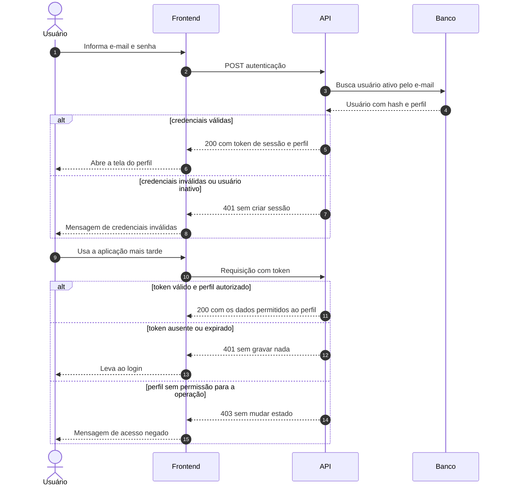

## Diagrama 2

### Pesquisa de disponibilidade

- **Cobre:** RF-03, RF-13 e RN-02, RN-04, RN-11, RN-14, RN-15, RN-26
- **Decisões:** A2, A6, B3, C5
- **Resumo:** Busca por tipo, capacidade, localização, competência e intervalo, com a fronteira [início, fim), a janela das salas e a regra de visibilidade.
- **Desfechos:**
  - Sucesso: 200 com recursos livres e intervalos ocupados sem identificar o dono
  - Erro: 400 por intervalo inválido
  - Erro: 401 ou 403 como no diagrama 1

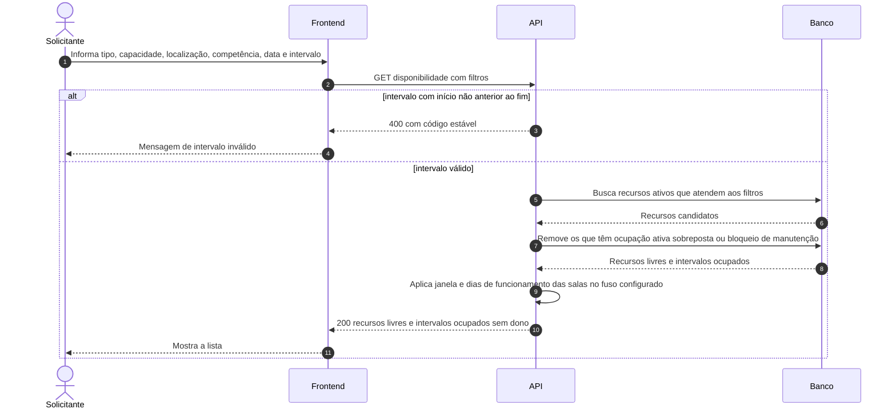

## Diagrama 3

### Criação de reserva com todos os desfechos

- **Cobre:** RF-04, RF-05, RF-07, RF-08, RF-11, RF-13 e RN-01, RN-02, RN-04, RN-09, RN-10, RN-11, RN-13, RN-14, RN-28
- **Decisões:** A1, A2, A5, A6, C6
- **Resumo:** Criação de reserva com sucesso aprovado automaticamente, sucesso pendente de aprovação, sobreposição, manutenção, professor ocupado e fora da janela da sala.
- **Desfechos:**
  - Sucesso: 201 APROVADA, com ator SISTEMA, quando não há recurso restrito
  - Sucesso: 201 SOLICITADA quando há recurso restrito
  - Erro: 403 para perfil sem permissão, como o Administrador
  - Erro: 400 por término não posterior ao início
  - Erro: 422 fora da janela ou em dia sem funcionamento
  - Erro: 409 por manutenção, sobreposição ou professor ocupado, com tentativa de conflito registrada

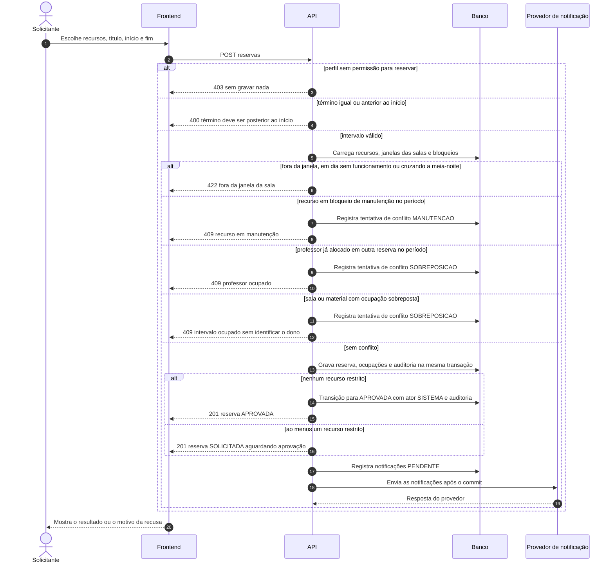

## Diagrama 4

### Duas solicitações simultâneas

- **Cobre:** RF-06, RF-05 e RN-03, RN-30, RN-02
- **Decisões:** A2, B4
- **Resumo:** Dois Solicitantes pedem o mesmo recurso e horário no mesmo instante. A constraint de exclusão do banco aceita um e recusa o outro.
- **Desfechos:**
  - Sucesso: um pedido recebe 201
  - Erro: o outro recebe 409 por concorrência, com tentativa de conflito CONCORRENCIA registrada
  - Resultado: exatamente uma ocupação ativa para o recurso e o intervalo

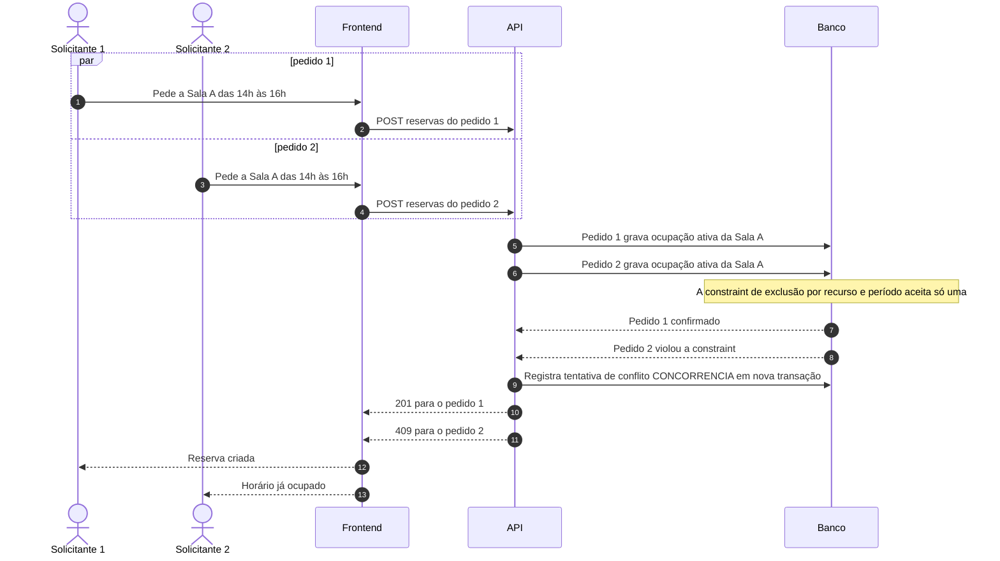

## Diagrama 5

### Aprovação e rejeição com motivo

- **Cobre:** RF-07, RF-11, RF-13 e RN-05, RN-06, RN-16, RN-24, RN-25, RN-33, RN-28
- **Decisões:** A1, B1, C2, D8
- **Resumo:** O Responsável decide sobre reserva SOLICITADA. Cobre aprovação, rejeição com motivo, rejeição sem motivo, decisão do próprio dono e estado inválido.
- **Desfechos:**
  - Sucesso: 200 com estado APROVADA ou rejeitada, auditoria e notificação ao Solicitante
  - Erro: 400 por rejeição sem motivo
  - Erro: 403 para o dono, Solicitante ou Administrador
  - Erro: 409 por reserva que não está em SOLICITADA

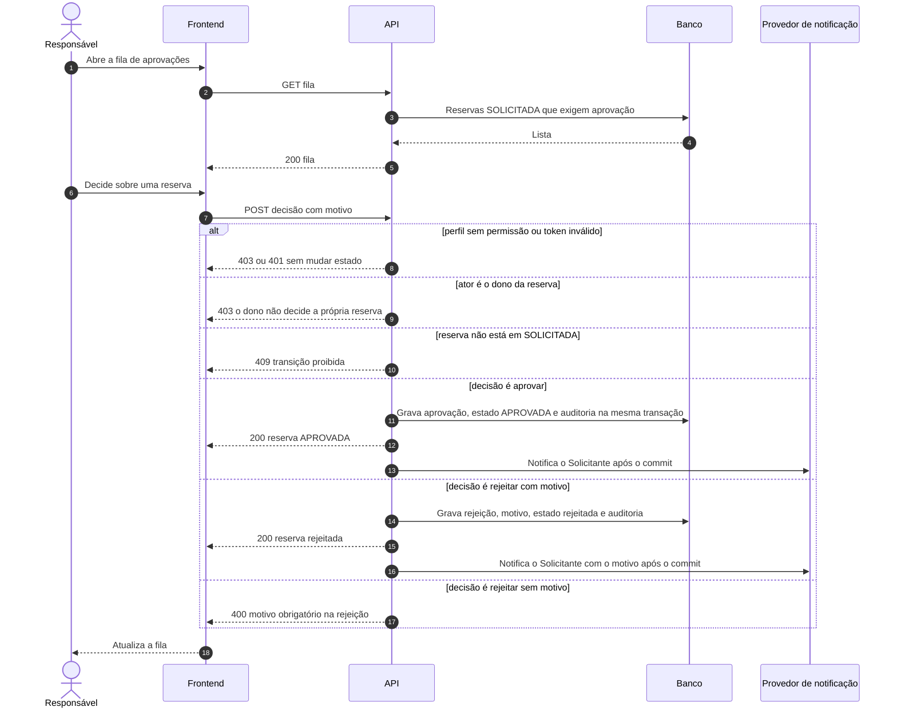

## Diagrama 6

### Início de uso, retirada, devolução e conclusão

- **Cobre:** RF-09, RF-16, RF-13 e RN-05, RN-12, RN-20, RN-23, RN-18
- **Decisões:** A3, A8, C3
- **Resumo:** O Responsável conduz o uso: registra início ou retirada, devolução e conclusão. Cobre devolução sem retirada e conclusão com material pendente.
- **Desfechos:**
  - Sucesso: APROVADA vai a EM_USO e depois a CONCLUÍDA, com auditoria
  - Erro: 409 por estado inválido, devolução sem retirada ou conclusão com unidades pendentes
  - Erro: 403 para perfil sem permissão

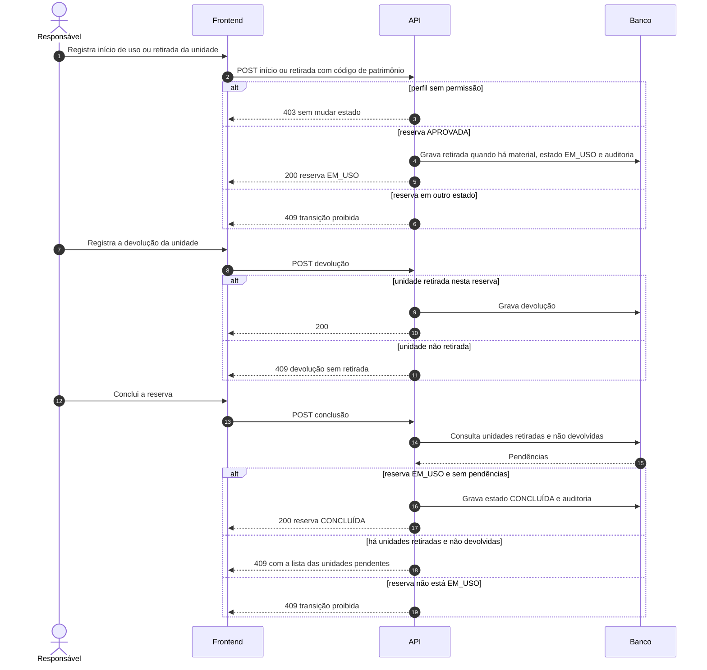

## Diagrama 7

### Alteração e cancelamento por estado e perfil

- **Cobre:** RF-04, RF-13 e RN-01, RN-02, RN-04, RN-05, RN-07, RN-18, RN-19, RN-27
- **Decisões:** A8, C1, B2
- **Resumo:** Alteração atômica pelo dono e cancelamento por estado e perfil. Nenhuma reserva é apagada: o cancelamento é mudança de estado.
- **Desfechos:**
  - Sucesso: 200 com estado mantido ou devolvido a SOLICITADA, conforme a regra de reaprovação
  - Sucesso: 200 com estado cancelada, motivo e auditoria
  - Erro: 409 por conflito na alteração, nada muda
  - Erro: 409 por estado que não permite a operação
  - Erro: 403 por perfil sem permissão, 400 por motivo ausente

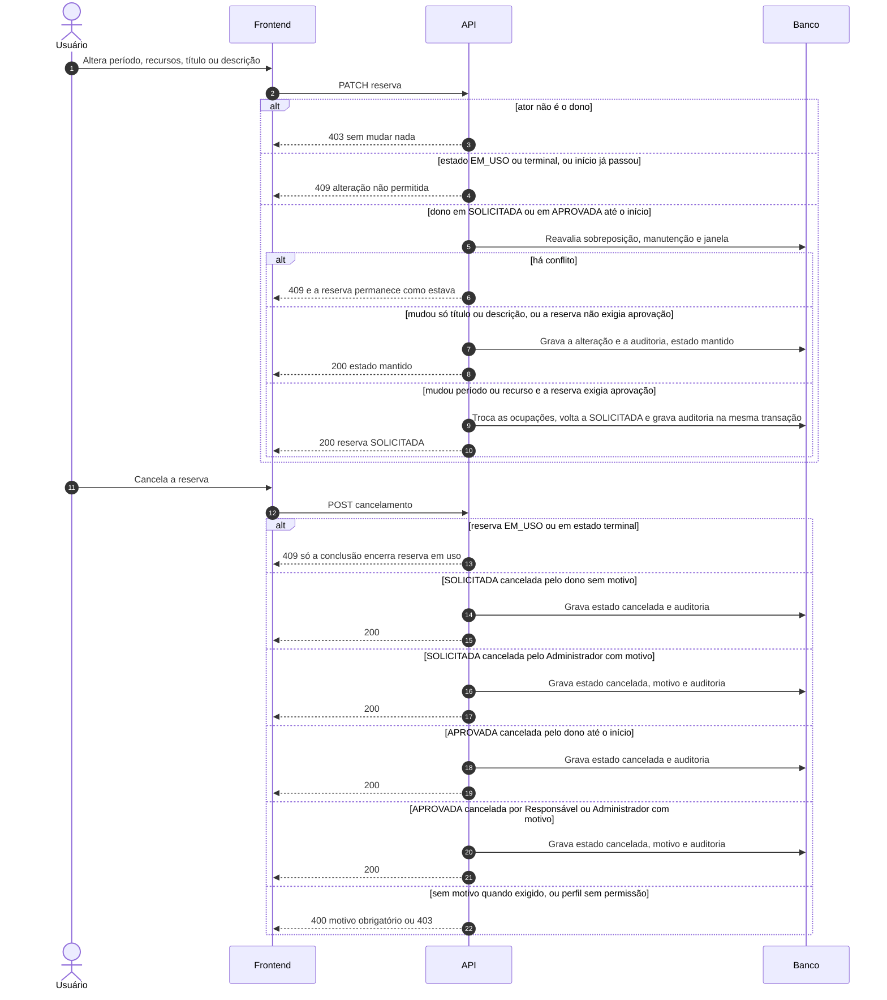

## Diagrama 8

### Bloqueio de manutenção com confirmação em dois passos

- **Cobre:** RF-08, RF-11, RF-13 e RN-04, RN-07, RN-11, RN-22, RN-28
- **Decisões:** A7, D7
- **Resumo:** O Administrador cria um bloqueio. Se houver reservas, a API primeiro lista os conflitos sem gravar e só grava depois da confirmação.
- **Desfechos:**
  - Passo 1: 409 com a lista, nada gravado
  - Passo 2 após confirmação: 201, bloqueio gravado e reservas cancelam por inteiro com motivo MANUTENCAO
  - Erro: 409 recusado sem opção de forçar, se houver reserva EM_USO
  - Erro: 403 para perfil sem permissão

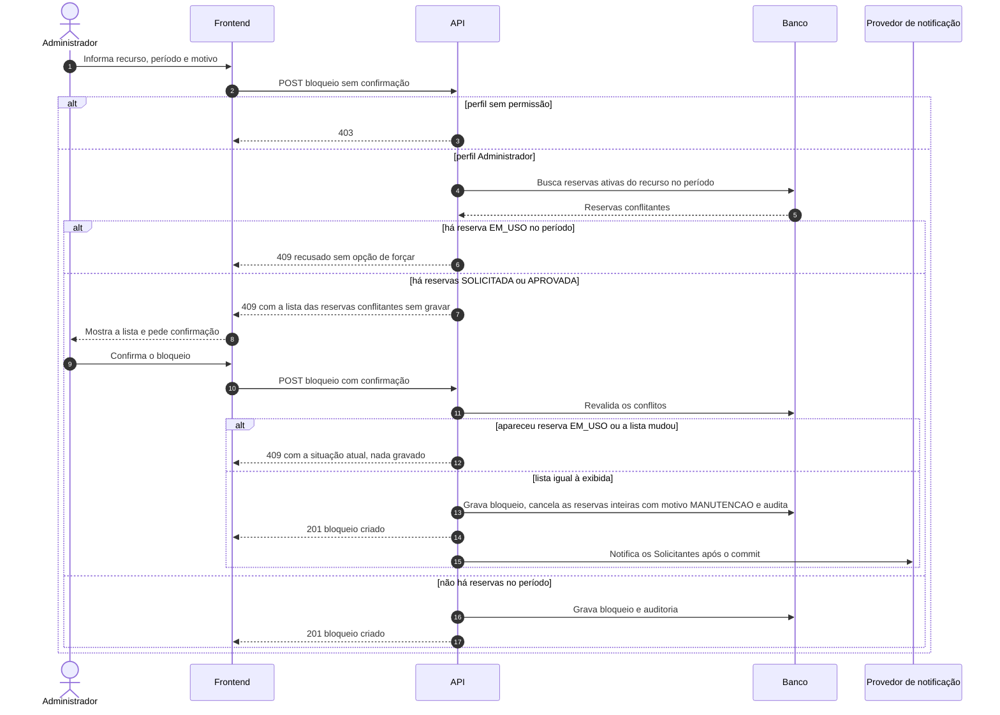

## Diagrama 9

### Não compareceu e cancelamento por falta de decisão

- **Cobre:** RF-16, RF-07, RF-11 e RN-05, RN-21, RN-25, RN-08
- **Decisões:** A8, C2, D1, D2
- **Resumo:** O Responsável marca não compareceu após a tolerância. Quando o início de uma reserva SOLICITADA chega sem decisão, o sistema a cancela com motivo SEM_DECISAO.
- **Desfechos:**
  - Sucesso: não compareceu ou cancelada com SEM_DECISAO, com auditoria
  - Erro: 409 por tolerância não encerrada ou estado inválido
  - Em aberto: valor da tolerância (D1). O mecanismo de disparo foi decidido em D2: job agendado, idempotente e com trava, só para SEM_DECISAO

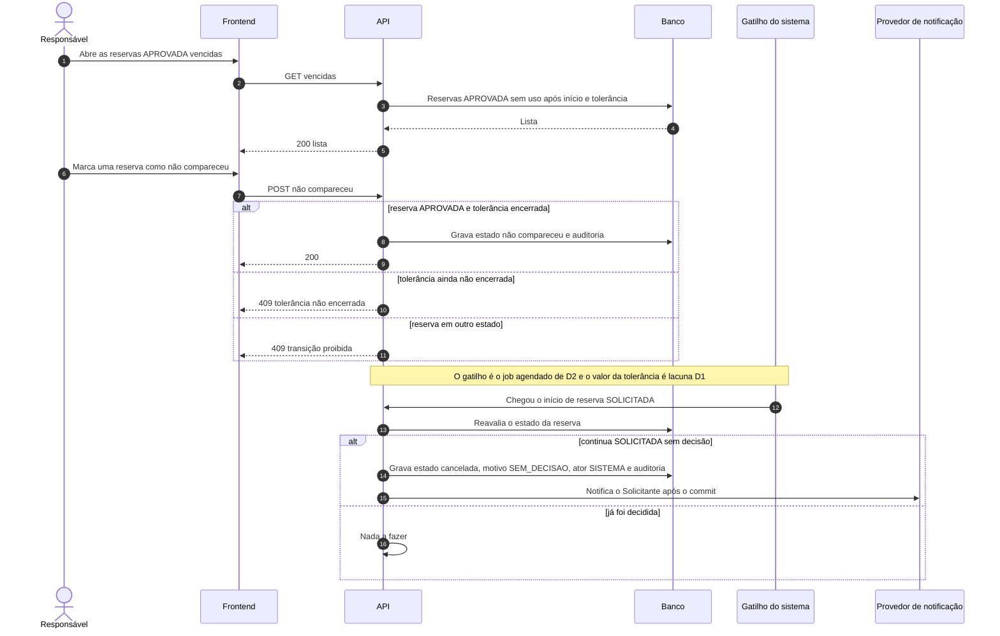

## Diagrama 10

### Relatório de utilização

- **Cobre:** RF-12, RF-13 e RN-26, RN-30, RN-31, RN-02, RN-03, RN-04, RN-15
- **Decisões:** B4, C4, C5, D4, D5
- **Resumo:** Relatório RF-12 com filtros e paginação. Responsável e Administrador consultam, este somente em leitura.
- **Desfechos:**
  - Sucesso: 200 com carga horária, utilização das salas e conflitos evitados
  - Erro: 403 para Solicitante
  - Erro: 400 por filtros inválidos
  - Em aberto: tamanho da página (D4)

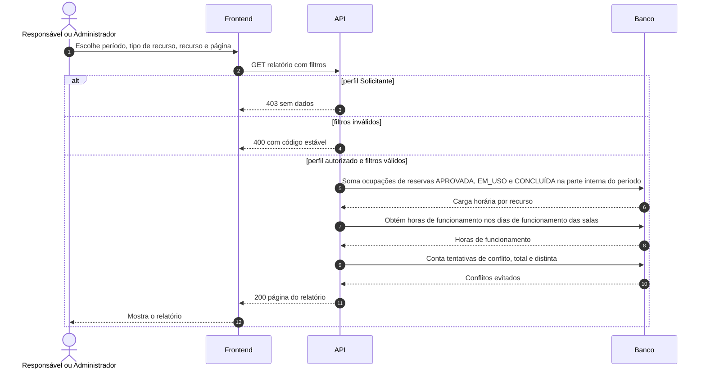

## Diagrama 11

### Cadastro, atributo restrito e desativação de recursos

- **Cobre:** RF-02, RF-13 e RN-10, RN-12, RN-13, RN-14, RN-29, RN-32
- **Decisões:** A1, A3, A4, A6, C5, C7, D6
- **Resumo:** O Administrador cadastra salas, professores e materiais, altera o atributo restrito e desativa recursos.
- **Desfechos:**
  - Sucesso: 201 no cadastro e 200 na alteração, com auditoria
  - Erro: 400 por dados incompletos e 409 por patrimônio duplicado
  - Erro: 409 na desativação com reservas futuras, com a lista e sem cancelamento automático

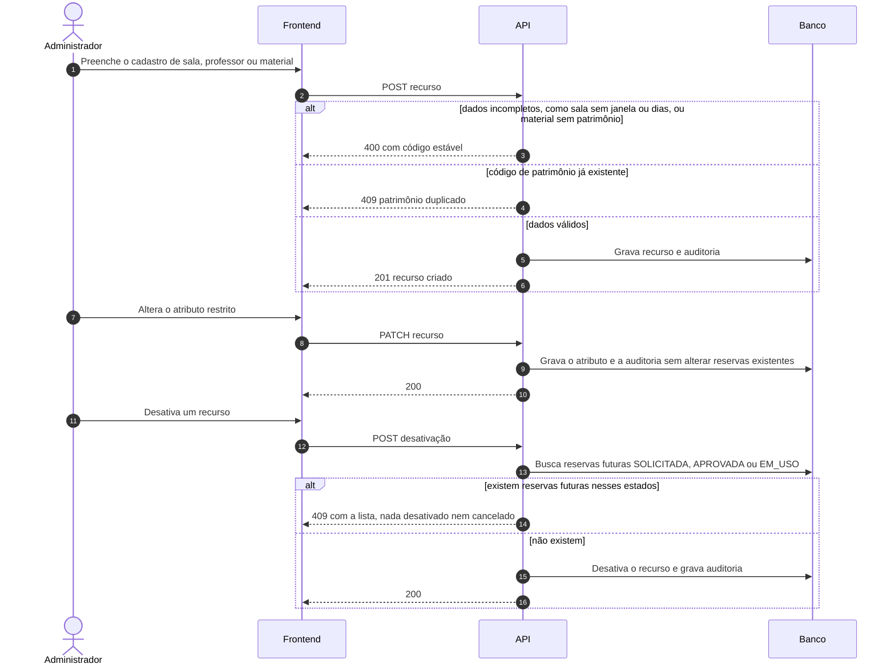

## Diagrama 12

### Gestão de usuários e perfis

- **Cobre:** RF-15, RF-01, RF-13 e RN-17, RN-29, RN-13
- **Decisões:** B2, C7, A4, C8
- **Resumo:** O Administrador cria e altera usuários e atribui um único perfil a cada um.
- **Desfechos:**
  - Sucesso: 201 ou 200 com auditoria contendo antes e depois
  - Erro: 400 por perfil ausente, 409 por segundo perfil ou e-mail repetido
  - Erro: 403 para quem não é Administrador

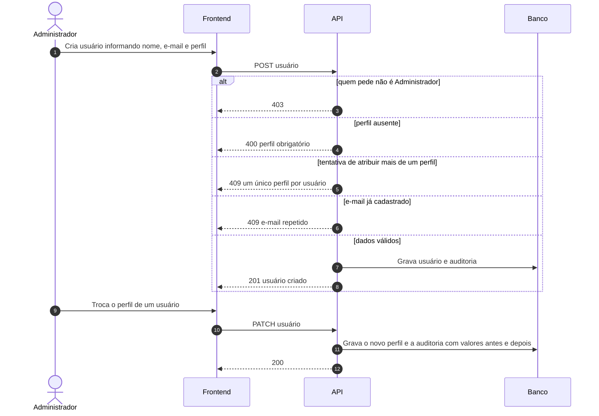

## Diagrama 13

### Consulta de histórico e auditoria

- **Cobre:** RF-10, RF-13 e RN-08, RN-26, RN-27, RN-29
- **Decisões:** B3, C4, C7, D9
- **Resumo:** Consulta do histórico das reservas e da auditoria completa, conforme o perfil.
- **Desfechos:**
  - Sucesso: 200 com eventos
  - Erro: 403 para o Responsável na auditoria de cadastros, usuários e perfis
  - Erro: 403 para Solicitante em reserva de outro usuário

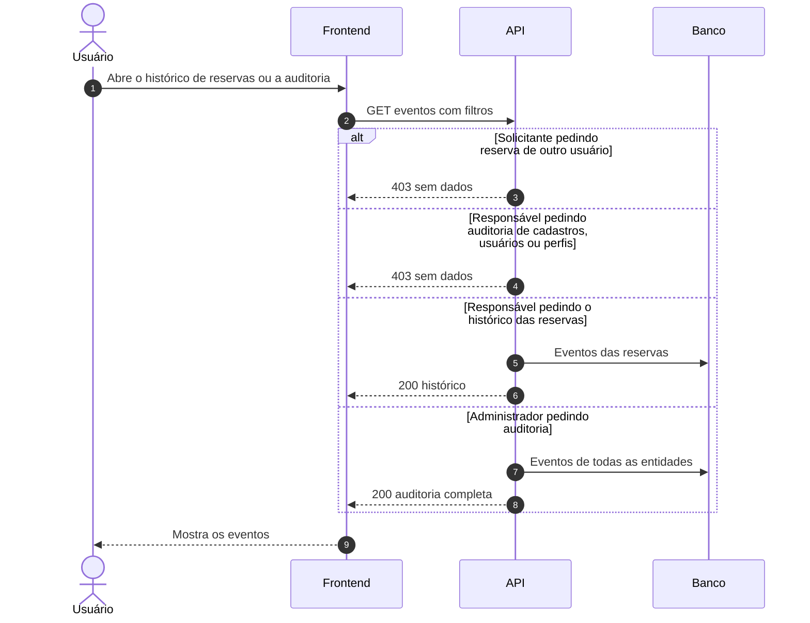

## Diagrama 14

### Documentação da API

- **Cobre:** RF-14
- **Decisões:** B3
- **Resumo:** Consulta à documentação do contrato público. A forma de publicação é suposição a confirmar na Fase 2.
- **Desfechos:**
  - Sucesso: 200 com operações, perfis, parâmetros, respostas e códigos de erro
  - Erro: 404 para documento inexistente

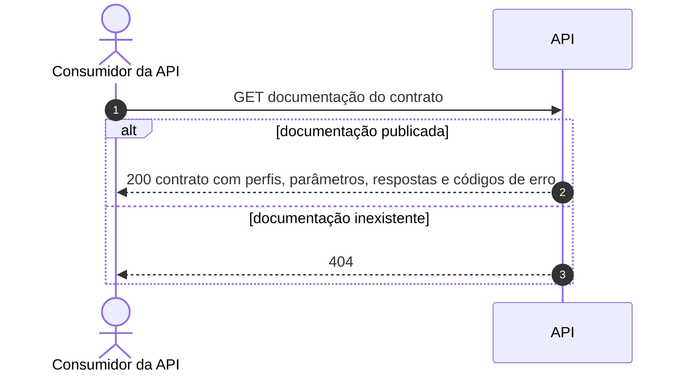

## Cobertura RF para diagrama

| RF | Requisito | Diagramas |
| --- | --- | --- |
| RF-01 | Autenticação e autorização por perfil | [1](#diagrama-1), [12](#diagrama-12) |
| RF-02 | Cadastro e consulta de salas, professores e materiais | [11](#diagrama-11) |
| RF-03 | Pesquisa por tipo, capacidade, localização, competência e disponibilidade | [2](#diagrama-2) |
| RF-04 | Criação, alteração e cancelamento de reservas | [3](#diagrama-3), [7](#diagrama-7) |
| RF-05 | Detecção de sobreposição de horários, inclusive na agenda do professor | [3](#diagrama-3), [4](#diagrama-4) |
| RF-06 | Proteção contra dupla reserva em solicitações simultâneas | [4](#diagrama-4) |
| RF-07 | Aprovação obrigatória para recursos restritos | [3](#diagrama-3), [5](#diagrama-5), [9](#diagrama-9) |
| RF-08 | Bloqueio de recursos em manutenção | [3](#diagrama-3), [8](#diagrama-8) |
| RF-09 | Registro de retirada e devolução de materiais e equipamentos | [6](#diagrama-6) |
| RF-10 | Histórico auditável de mudanças | [13](#diagrama-13) |
| RF-11 | Notificação simulada ou integração com API externa | [3](#diagrama-3), [5](#diagrama-5), [8](#diagrama-8), [9](#diagrama-9) |
| RF-12 | Relatório de utilização por recurso, carga horária alocada e conflitos evitados | [10](#diagrama-10) |
| RF-13 | Interface responsiva e mensagens de erro compreensíveis | [1](#diagrama-1), [2](#diagrama-2), [3](#diagrama-3), [5](#diagrama-5), [6](#diagrama-6), [7](#diagrama-7), [8](#diagrama-8), [10](#diagrama-10), [11](#diagrama-11), [12](#diagrama-12), [13](#diagrama-13) |
| RF-14 | Documentação de API ou dos fluxos públicos do sistema | [14](#diagrama-14) |
| RF-15 | Gestão de usuários e perfis (acréscimo da equipe) | [12](#diagrama-12) |
| RF-16 | Ciclo de vida de uso da reserva (acréscimo da equipe) | [6](#diagrama-6), [9](#diagrama-9) |

| Verificação | Resultado |
| --- | --- |
| RF sem diagrama | Nenhum |

RF-13 é transversal: aparece em todo diagrama que tem ramo de erro com mensagem ao usuário. RF-10 está também implícito em todo diagrama que grava auditoria.

## Regras sem diagrama próprio

| Verificação | Resultado |
| --- | --- |
| RN não citadas em nenhum diagrama | Nenhuma |

As regras listadas acima são de modelagem ou de configuração e não têm interação própria entre atores. Elas continuam cobertas pelas jornadas e pelo modelo de dados.
