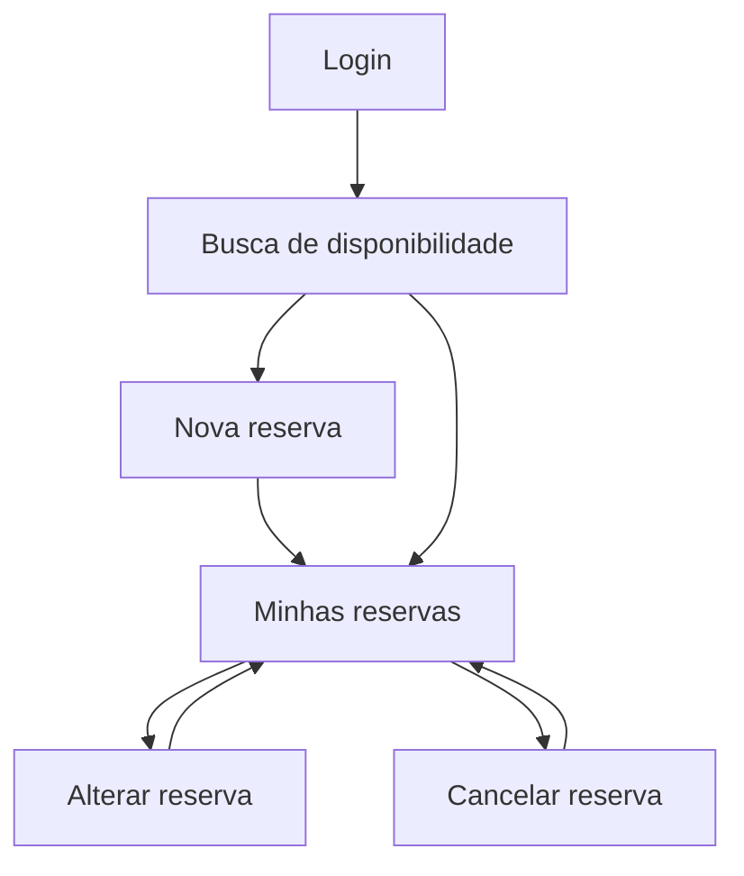
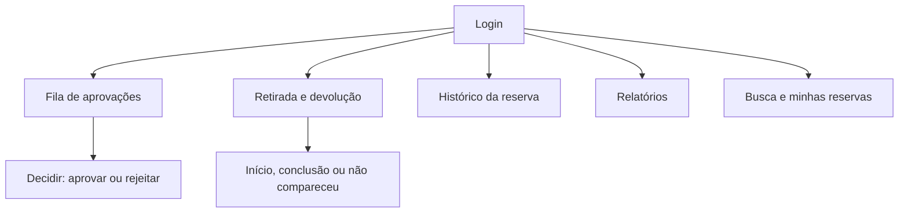
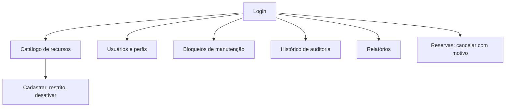

# Navegação e telas do front end

Fonte dos requisitos: [requisitos-funcionais.md](requisitos-funcionais.md) (RF-13 em especial) e a [especificação do projeto](https://afonsolelis.github.io/aulas_senac/pages/qualidade2/especificacao-projeto.html), seção 3. Jornadas: [Solicitante](personas/solicitante.md), [Responsável](personas/responsavel.md) e [Administrador](personas/administrador.md). Stack e regras do front end: [ADR-015](../adr/ADR-015-stack-do-front-end.md). Contrato: [openapi.json](../api/openapi.json). Códigos de erro: `CodigoErro.java` e [ADR-008](../adr/ADR-008-erros-padronizados-e-consultas-parametrizadas.md).

Este documento é a entrada do Prompt 6.A do plano mestre. Ele não contém código. Cada tela vira uma fatia em TDD no Prompt 6.C.

Legenda: **fato** (vem do repositório, com arquivo), **decisão** (da equipe, com ID), **suposição** (com impacto) e **lacuna** (sem decisão, listada na seção 7).

## 1. Princípios que valem para todas as telas

| Princípio | Origem |
| --- | --- |
| O front nunca decide sobreposição, aprovação, posse nem transição de estado. Ele envia o pedido e mostra a resposta do servidor | ADR-004; plano mestre, seção 10.3 (3) |
| Esconder um botão por perfil é conveniência. A segurança é o 403 do servidor, e o front também sabe exibir esse 403 | ADR-004; RF-01 |
| Toda mensagem de erro vem da tabela da seção 5, indexada pelo código estável. O texto cru do servidor nunca aparece | ADR-008; plano mestre, seção 10.3 (2) |
| Nenhuma mensagem identifica terceiros | RF-13, critério 2; B3 |
| Layout *mobile-first*, validado em 360 px e 1280 px. Todo campo tem rótulo, todo elemento interativo tem foco visível e o contraste é conferido | F6-04; plano mestre, seção 10.3 (5) |
| Datas exibidas no fuso do campus e enviadas em ISO-8601 com offset. O fuso é configuração do front (padrão `America/Sao_Paulo`, decisão A6) | ADR-005; ADR-015 |
| Cada tela trata os estados carregando, vazio, erro e sucesso | Plano mestre, seção 10.2 |
| Sessão expirada (401) apaga o token e leva ao login sem gravar dados | RF-13, critério 4; ADR-015 |

## 2. Mapa de navegação por perfil

O perfil vem de `GET /api/auth/eu` e do login (`LoginResposta.perfil`). Um usuário tem exatamente um perfil (RF-15).

### 2.1 Solicitante



### 2.2 Responsável

O Responsável também cria reservas próprias (RF-04), então vê as telas do Solicitante além das suas.



### 2.3 Administrador

O Administrador não cria nem aprova reserva (RN-17). Ele cancela com motivo e lê o relatório.



## 3. Matriz de acesso por tela

Os perfis abaixo refletem as regras de rota do servidor em `SegurancaConfig.java` (fato) e os RF. A tela é escondida para os demais perfis por conveniência. O servidor continua recusando com 403.

| Tela | Solicitante | Responsável | Administrador | RF |
| --- | --- | --- | --- | --- |
| T01 Login | Sim | Sim | Sim | RF-01 |
| T02 Busca de disponibilidade | Sim | Sim | Consulta | RF-03 |
| T03 Nova reserva e alteração | Sim | Sim | Não (RN-17) | RF-04, RF-05, RF-06 |
| T04 Minhas reservas e cancelamento | Sim | Sim | Cancela com motivo | RF-04 |
| T05 Fila de aprovações | Não | Sim | Não | RF-07 |
| T06 Retirada e devolução | Não | Sim | Não | RF-09, RF-16 |
| T07 Catálogo de recursos | Consulta | Consulta | Sim | RF-02 |
| T08 Bloqueios de manutenção | Não | Não | Sim | RF-08 |
| T09 Histórico de auditoria | Não | Histórico de reserva | Auditoria completa | RF-10 |
| T10 Relatórios | Não | Sim | Sim | RF-12 |
| T11 Usuários e perfis | Não | Não | Sim | RF-15 |

## 4. Telas

Em cada tela, "mensagem" refere-se à seção 5. Os códigos listados são os que o endpoint pode devolver segundo a regra de negócio; a tela ainda trata `NAO_AUTENTICADO`, `ACESSO_NEGADO`, `ERRO_INTERNO` e a falha de rede de forma comum (seção 5.2).

### T01. Login

- **Objetivo:** abrir uma sessão. **Endpoint:** `POST /api/auth/login`; depois `GET /api/auth/eu`.
- **Dados exibidos:** e-mail e senha. Nada é lembrado entre sessões.
- **Ações:** entrar. Depois do login o usuário vai à tela inicial do perfil: Busca (Solicitante), Fila de aprovações (Responsável) e Catálogo (Administrador). Isto é uma **suposição** de conveniência; impacto: só muda a rota inicial.
- **Estados:** carregando (botão desativado), erro, sucesso (redireciona).
- **Erros:** `CREDENCIAIS_INVALIDAS`, `VALIDACAO_FALHOU` (campo vazio). Conta bloqueada pelo limite de tentativas (decisão D18) recebe a mesma resposta de `CREDENCIAIS_INVALIDAS` (P5-10b, fato em `AutenticacaoService.java`), então a tela não tem mensagem própria para ela e não revela o bloqueio.

```text
+--------------------------+
|  Organização de Recursos |
|  E-mail  [____________]  |
|  Senha   [____________]  |
|  [ Entrar ]              |
|  (mensagem de erro aqui) |
+--------------------------+
```

### T02. Busca de disponibilidade

- **Objetivo:** achar recurso livre num intervalo. **Endpoints:** `GET /api/recursos` (tipo, capacidadeMinima, localizacao, competencia, inicio, fim) e `GET /api/recursos/{id}/ocupacoes` para o detalhe.
- **Dados exibidos:** nome, tipo, capacidade, localização, janela e dias de funcionamento (sala), competências (professor), restrito. As ocupações mostram só o intervalo, sem dono (RF-03, critério 5).
- **Ações:** filtrar, limpar filtros, escolher recurso para reservar (leva à T03 com o recurso e o intervalo preenchidos).
- **Estados:** carregando, vazio ("nenhum recurso livre neste intervalo"), erro, sucesso. Início e fim só são enviados juntos.
- **Erros:** `VALIDACAO_FALHOU`, `PERIODO_INVALIDO`.

```text
Tipo [Sala v] Capacidade mín. [__] Local [____]
Início [__/__/____ __:__]  Fim [__/__/____ __:__]
[ Buscar ]
-------------------------------------------------
Sala 101 · cap. 40 · Bloco A        [ Reservar ]
Sala 203 · cap. 30 · Bloco B        [ Reservar ]
```

### T03. Nova reserva e alteração

- **Objetivo:** criar ou alterar uma reserva. **Endpoints:** `POST /api/reservas` e `PUT /api/reservas/{id}`.
- **Dados:** título, descrição, início, fim e um ou mais recursos (sala, professor, material). A tela mostra se o servidor marcou "exige aprovação" na resposta; ela não calcula isso.
- **Ações:** enviar, cancelar edição. A alteração é atômica no servidor (RN-19).
- **Estados:** carregando, erro por campo, conflito, sucesso (vai à T04 com a reserva criada em destaque).
- **Erros:** `VALIDACAO_FALHOU`, `PERIODO_INVALIDO`, `INICIO_NO_PASSADO`, `FORA_DA_JANELA`, `DIA_SEM_FUNCIONAMENTO`, `CRUZA_MEIA_NOITE`, `CONFLITO_DE_ALOCACAO` (inclui professor ocupado, RF-05), `RECURSO_EM_MANUTENCAO`, `RECURSO_INATIVO`, `RESERVA_JA_INICIADA`, `TRANSICAO_PROIBIDA`, `NAO_ENCONTRADO`.

```text
Título    [______________________]
Descrição [______________________]
Início [__/__/____ __:__]  Fim [__/__/____ __:__]
Recursos  [x] Sala 101  [ ] Projetor 7   [+ adicionar]
[ Reservar ]
! O recurso já está reservado neste horário. Escolha outro horário ou recurso.
```

### T04. Minhas reservas e cancelamento

- **Objetivo:** acompanhar, alterar e cancelar. **Endpoints:** `GET /api/reservas`, `GET /api/reservas/{id}`, `POST /api/reservas/{id}/cancelamento`.
- **Dados:** título, período, estado (SOLICITADA, APROVADA, EM_USO, CONCLUIDA e demais, na grafia de RN-05), recursos (nome resolvido por `GET /api/recursos/{id}`), motivo quando houver. O Solicitante vê só as próprias (RN-26).
- **Ações:** alterar (volta à T03), cancelar com motivo. O Administrador cancela com motivo (RF-04). A tela mostra a ação se o estado permite, mas quem decide é o servidor.
- **Estados:** carregando, vazio, erro, sucesso. Reserva cancelada continua listada com estado e motivo (RN-27).
- **Erros:** `RESERVA_JA_INICIADA`, `TRANSICAO_PROIBIDA`, `MOTIVO_OBRIGATORIO`, `ACESSO_NEGADO`, `NAO_ENCONTRADO`.

```text
Minhas reservas
Aula extra · 20/10 14:00-16:00 · Sala 101 · APROVADA [Alterar][Cancelar]
Prova       · 22/10 08:00-10:00 · Sala 203 · SOLICITADA [Alterar][Cancelar]
```

### T05. Fila de aprovações

- **Objetivo:** decidir reservas com recurso restrito. **Endpoints:** `GET /api/reservas/fila`, `POST /api/reservas/{id}/aprovacao`, `POST /api/reservas/{id}/rejeicao`.
- **Dados:** título, período, recursos, identificador do solicitante. A resposta da fila traz `solicitanteNome`, só o nome e nunca o e-mail (F6-06b, lacuna **L-04**, CT-125 e CT-126), além de `solicitanteId`.
- **Ações:** aprovar (motivo opcional, suposição: o contrato aceita `DecisaoRequisicao`) e rejeitar (motivo obrigatório, RN-24).
- **Estados:** carregando, vazio ("sem pendências"), erro, sucesso (o item sai da fila).
- **Erros:** `MOTIVO_OBRIGATORIO`, `ACESSO_NEGADO` (dono tenta decidir, RN-16 e RN-33), `APROVACAO_APOS_INICIO`, `TRANSICAO_PROIBIDA`, `NAO_ENCONTRADO`.

```text
Pendentes de aprovação
#41 · Projetor 7 · 20/10 14:00-16:00 · solicitante #12
    [ Aprovar ]  [ Rejeitar ]   Motivo [_____________]
```

### T06. Retirada e devolução

- **Objetivo:** registrar uso de material e o ciclo da reserva. **Endpoints:** `POST /api/reservas/{id}/inicio`, `/retiradas`, `/devolucoes`, `/conclusao`, `/nao-comparecimento`; `GET /api/reservas/{id}/movimentacoes`.
- **Dados:** reservas APROVADA e EM_USO, unidades de material e seu estado (retirada ou devolvida), quem registrou e quando.
- **Ações:** iniciar uso, retirar unidade, devolver unidade, concluir, marcar não compareceu.
- **Estados:** carregando, vazio, erro, sucesso.
- **Erros:** `TRANSICAO_PROIBIDA`, `MATERIAL_FORA_DA_RESERVA`, `MATERIAL_JA_RETIRADO`, `DEVOLUCAO_SEM_RETIRADA`, `MATERIAL_PENDENTE` (a lista de pendentes vem em `itens`, se o servidor a enviar), `TOLERANCIA_NAO_CONFIGURADA`, `TOLERANCIA_NAO_ENCERRADA`, `ACESSO_NEGADO`.

```text
Reserva #41 · EM_USO
Projetor 7   retirado 14:02   [ Devolver ]
Notebook 3   não retirado     [ Retirar ]
[ Concluir reserva ]   [ Não compareceu ]
```

### T07. Catálogo de recursos

- **Objetivo:** cadastrar e manter salas, professores e materiais. **Endpoints:** `GET /api/recursos`, `POST /api/salas`, `POST /api/professores`, `POST /api/materiais`, `PUT /api/recursos/{id}/restrito`, `POST /api/recursos/{id}/desativacao`.
- **Dados:** os atributos de `RecursoResposta`. Sala: capacidade, localização, tipo de sala, janela e dias. Material: código de patrimônio. Professor: competências e vínculo opcional com usuário.
- **Ações:** cadastrar, marcar ou desmarcar restrito, desativar. Alterar "restrito" não muda reservas existentes (RF-02, critério 4) e a tela avisa isso.
- **Estados:** carregando, vazio, erro, sucesso. Solicitante e Responsável só consultam.
- **Erros:** `VALIDACAO_FALHOU`, `PATRIMONIO_JA_EXISTE`, `VINCULO_JA_EXISTE`, `RECURSO_COM_RESERVA_FUTURA`, `NAO_ENCONTRADO`, `ACESSO_NEGADO`.

```text
[ Salas | Professores | Materiais ]            [ + Novo ]
Sala 101 · cap. 40 · restrito [ ]   [Desativar]
Projetor 7 · patrimônio P-0007 · restrito [x] [Desativar]
```

### T08. Bloqueios de manutenção

- **Objetivo:** impedir reservas de um recurso por um período. **Endpoints:** `POST /api/bloqueios` e `POST /api/bloqueios/{id}/levantamento`.
- **Fluxo em duas etapas (RN-22):** o primeiro envio pode voltar `BLOQUEIO_PENDE_CONFIRMACAO` com a lista de reservas afetadas em `itens`. A tela mostra a lista e, se o Administrador confirmar, reenvia com `reservasConfirmadas`. Se a lista mudou, volta `BLOQUEIO_LISTA_DESATUALIZADA` e o ciclo recomeça. Com reserva em uso, `BLOQUEIO_COM_RESERVA_EM_USO` recusa e não há opção de forçar.
- **Dados:** recurso, período, motivo. O servidor devolve `reservasCanceladas`.
- **Estados:** carregando, pendente de confirmação, erro, sucesso.
- **Listagem:** `GET /api/bloqueios` foi acrescentado ao back end (F6-06a, lacuna **L-02**, CT-123 e CT-124) e devolve bloqueios ativos e levantados, em ordem de início. A tela mostra o campo `ativo` e só oferece levantar os ativos.
- **Erros:** `BLOQUEIO_PENDE_CONFIRMACAO`, `BLOQUEIO_LISTA_DESATUALIZADA`, `BLOQUEIO_COM_RESERVA_EM_USO`, `MOTIVO_OBRIGATORIO`, `PERIODO_INVALIDO`, `NAO_ENCONTRADO`.

```text
Recurso [Sala 101 v]  Início [_______]  Fim [_______]
Motivo  [__________________]
[ Bloquear ]
Reservas afetadas: #41, #44   [ Confirmar e cancelar ]  [ Voltar ]
```

### T09. Histórico de auditoria

- **Objetivo:** consultar o que mudou. **Endpoints:** `GET /api/reservas/{id}/historico` (Responsável e Administrador) e `GET /api/auditoria` com `entidade` e `entidadeId` (só Administrador).
- **Dados:** instante, ator (inclusive SISTEMA), ação, estado anterior e novo, motivo.
- **Ações:** filtrar por reserva (Responsável) ou por entidade (Administrador). Não existe edição nem exclusão de evento (RF-10, critério 3).
- **Estados:** carregando, vazio, erro, sucesso. O filtro por período é feito no front sobre a lista inteira, porque a consulta não é paginada (F6-06, lacuna **L-03**).
- **Erros:** `ACESSO_NEGADO` (Responsável na auditoria completa), `NAO_ENCONTRADO`.

### T10. Relatórios

- **Objetivo:** utilização, carga horária e conflitos evitados. **Endpoint:** `GET /api/relatorios/utilizacao` (inicio, fim, tipo, recursoId, pagina, tamanho).
- **Dados:** por recurso, `horasAlocadas`, `utilizacao`, `conflitosEvitados` e `solicitantesDistintos`; `total` e página. Os números são exibidos como o servidor calcula; o front não recalcula (RN-31).
- **Ações:** filtrar por período, tipo e recurso, paginar. O tamanho de página é obrigatório no contrato e sem valor decidido (lacuna D4); o front usa um valor de configuração marcado como suposição.
- **Estados:** carregando, vazio, erro, sucesso. Somente leitura.
- **Erros:** `VALIDACAO_FALHOU`, `PERIODO_INVALIDO`, `ACESSO_NEGADO`.

### T11. Usuários e perfis

- **Objetivo:** gerir usuários. **Endpoints:** `GET /api/usuarios`, `POST /api/usuarios`, `PUT /api/usuarios/{id}/perfil`, `POST /api/usuarios/{id}/desativacao`.
- **Dados:** nome, e-mail, perfil, ativo. A senha só é enviada na criação e nunca é exibida nem guardada.
- **Ações:** criar com um único perfil, trocar perfil, desativar. Desativar revoga as sessões do usuário (fato, resumo do endpoint).
- **Estados:** carregando, vazio, erro, sucesso.
- **Erros:** `USUARIO_JA_EXISTE`, `MINIMO_DE_RESPONSAVEIS`, `USUARIO_COM_RESERVA_FUTURA`, `VALIDACAO_FALHOU`, `NAO_ENCONTRADO`, `ACESSO_NEGADO`.

## 5. Mapa de erros: código estável para mensagem e ação

O servidor devolve Problem Details com o campo `code` (fato, `TratadorDeErros.java`). Os 34 códigos abaixo são os de `CodigoErro.java`. O texto é **proposta** para aprovação e cada linha vira um teste de componente no 6.B. O campo `itens` traz identificadores (por exemplo reservas afetadas) e `campos` traz os nomes dos campos inválidos; a tela usa os dois apenas como dado, nunca como texto.

### 5.1 Tabela

| Código | HTTP | Mensagem para a pessoa | Ação sugerida |
| --- | --- | --- | --- |
| CREDENCIAIS_INVALIDAS | 401 | E-mail ou senha incorretos. | Confira os dados e tente de novo. |
| NAO_AUTENTICADO | 401 | Sua sessão terminou ou ainda não foi aberta. | Entre novamente (a tela leva ao login). |
| ACESSO_NEGADO | 403 | Seu perfil não permite esta ação. | Volte à tela anterior ou fale com um Administrador. |
| VALIDACAO_FALHOU | 400 | Alguns dados não foram aceitos. | Corrija os campos destacados e envie de novo. |
| NAO_ENCONTRADO | 404 | Não encontramos o item pedido. | Volte à lista e atualize a página. |
| USUARIO_JA_EXISTE | 409 | Já existe um usuário com este e-mail. | Use outro e-mail. |
| MINIMO_DE_RESPONSAVEIS | 409 | A mudança deixaria menos de dois Responsáveis ativos. | Cadastre outro Responsável antes de continuar. |
| USUARIO_COM_RESERVA_FUTURA | 409 | Este usuário tem reservas futuras e não pode ser desativado. | Cancele ou conclua as reservas e tente de novo. |
| PATRIMONIO_JA_EXISTE | 409 | Já existe um material com este código de patrimônio. | Confira o código informado. |
| VINCULO_JA_EXISTE | 409 | Este usuário já está ligado a outro professor. | Escolha outro usuário ou deixe sem vínculo. |
| RECURSO_COM_RESERVA_FUTURA | 409 | Este recurso tem reservas futuras e não pode ser desativado. | Cancele as reservas antes de desativar. |
| PERIODO_INVALIDO | 400 | O término precisa ser depois do início. | Ajuste as datas e horas. |
| INICIO_NO_PASSADO | 400 | O início da reserva precisa ser no futuro. | Escolha um horário a partir de agora. |
| FORA_DA_JANELA | 400 | O horário está fora do funcionamento da sala. | Escolha um horário dentro da janela da sala. |
| DIA_SEM_FUNCIONAMENTO | 400 | A sala não funciona neste dia da semana. | Escolha outro dia. |
| CRUZA_MEIA_NOITE | 400 | A reserva não pode passar da meia-noite. | Divida em dois dias ou termine antes da meia-noite. |
| MOTIVO_OBRIGATORIO | 400 | Informe o motivo para continuar. | Preencha o campo motivo. |
| CONFLITO_DE_ALOCACAO | 409 | Um dos recursos já está reservado nesse horário. | Escolha outro horário ou outro recurso. |
| RECURSO_EM_MANUTENCAO | 409 | O recurso está em manutenção nesse horário. | Escolha outro horário ou outro recurso. |
| TRANSICAO_PROIBIDA | 409 | A reserva não está num estado que permita esta ação. | Atualize a lista para ver o estado atual. |
| RESERVA_JA_INICIADA | 409 | A reserva já começou e não pode mais ser alterada ou cancelada por você. | Fale com um Responsável se precisar de ajuda. |
| RECURSO_INATIVO | 409 | Um dos recursos está desativado. | Retire-o da reserva e tente de novo. |
| METODO_NAO_PERMITIDO | 405 | Esta operação não existe. | Volte ao início e tente de novo. |
| APROVACAO_APOS_INICIO | 409 | O horário de início já passou e a reserva não pode mais ser aprovada. | Atualize a fila. |
| BLOQUEIO_PENDE_CONFIRMACAO | 409 | Há reservas neste período. Elas serão canceladas se você confirmar. | Revise a lista exibida e confirme ou volte. |
| BLOQUEIO_LISTA_DESATUALIZADA | 409 | A lista de reservas mudou desde a sua última revisão. | Revise a nova lista e confirme de novo. |
| BLOQUEIO_COM_RESERVA_EM_USO | 409 | Há uma reserva em uso neste período, então o bloqueio não pode ser criado. | Escolha um período sem reservas em uso. |
| MATERIAL_FORA_DA_RESERVA | 400 | Este material não faz parte da reserva. | Escolha um material da lista da reserva. |
| MATERIAL_JA_RETIRADO | 409 | Esta unidade já foi retirada e ainda não voltou. | Registre a devolução antes de retirar de novo. |
| DEVOLUCAO_SEM_RETIRADA | 409 | Esta unidade não foi retirada. | Registre a retirada antes da devolução. |
| MATERIAL_PENDENTE | 409 | Há material retirado e não devolvido. | Registre a devolução das unidades pendentes e conclua de novo. |
| TOLERANCIA_NAO_CONFIGURADA | 409 | A tolerância de não comparecimento ainda não foi configurada. | Peça a um Administrador que configure. |
| TOLERANCIA_NAO_ENCERRADA | 409 | A tolerância de não comparecimento ainda não terminou. | Tente depois do prazo. |
| ERRO_INTERNO | 500 | Não foi possível concluir agora. | Tente de novo em instantes. |

### 5.2 Casos sem código do servidor

| Situação | Mensagem | Ação |
| --- | --- | --- |
| Falha de rede ou servidor fora do ar (sem resposta) | Não conseguimos falar com o servidor. | Verifique sua conexão e tente de novo. |
| Código desconhecido (servidor mais novo que o front) | Não foi possível concluir a operação. | Tente de novo. Se persistir, avise a equipe. |
| Resposta de erro sem corpo no formato esperado | Não foi possível concluir a operação. | Tente de novo. |

A mensagem do texto genérico não repete nada do corpo da resposta.

## 6. Estados comuns de tela

| Estado | Comportamento |
| --- | --- |
| Carregando | Indicador acessível (`aria-busy`) e botões de envio desativados para impedir duplo envio |
| Vazio | Texto que diz o que fazer, sem apresentar como erro |
| Erro | Mensagem da seção 5 em região `role="alert"`, mais o botão "Tentar de novo" quando a operação é repetível |
| Sucesso | Confirmação curta e retorno à lista, com o item atualizado a partir do servidor |

## 7. Lacunas e riscos do contrato

Todas decididas por Jefferson em 18/10/2026 (F6-05, F6-06 e F6-10).

| ID | Lacuna | Impacto no front | Opções conformes ao plano |
| --- | --- | --- | --- |
| L-01 | O OpenAPI não descreve o corpo de erro (`code`, `itens`, `campos`) | O tipo do erro não vem do gerador | **Decidida (F6-05, 18/10/2026):** tipo mínimo escrito à mão num único módulo, coberto por teste que o compara com `TratadorDeErros`. O back end não muda |
| L-02 | Não existia `GET /api/bloqueios` | A tela T08 não listaria bloqueios antigos | **Decidida e feita (F6-06a, 18/10/2026):** endpoint acrescentado ao back end em TDD, com `openapi.json` atualizado no mesmo PR |
| L-03 | `GET /api/auditoria` filtra só por `entidade` e `entidadeId`, não por período | O plano cita filtro por período na T09 | **Decidida (F6-06, 18/10/2026):** filtro no front. Condição de Jefferson verificada: a consulta não é paginada (`JdbcAuditoriaRepository.java`, sem `limit`), então o filtro vale sobre o resultado inteiro. **Risco:** a resposta cresce sem limite (retenção D9 aberta); se a paginação entrar, o filtro precisa migrar para o servidor |
| L-04 | O nome do solicitante só estava em `GET /api/usuarios`, restrito ao Administrador | A fila de aprovações mostraria só o identificador | **Decidida e feita (F6-06b, 18/10/2026):** a fila traz só o nome do solicitante, nunca o e-mail, em TDD, com `openapi.json` atualizado no mesmo PR |
| L-05 | Fuso do campus: o front assume `America/Sao_Paulo`, que é a decisão A6 da equipe; não há resposta do professor sobre isso | Datas exibidas no fuso errado se a decisão mudar | Variável de ambiente do front; muda sem alterar código |
| L-06 | Os esquemas de resposta do OpenAPI não declaravam `required`, então todo campo de resposta virava opcional no tipo gerado | As telas teriam de validar cada resposta | **Decidida e feita (F6-10, 18/10/2026):** alternativa B, o back end marca como obrigatórios só os campos que nunca são nulos (só documentação). Cliente regenerado; as telas já nascem com tipos precisos. Campos de fora e motivos em [decisoes-equipe.md](../decisoes-equipe.md) |

As colunas "Opções" listam o que foi considerado; a decisão está marcada em cada linha.

## 8. Rastreabilidade das telas

| Tela | RF | Teste de componente | Teste E2E |
| --- | --- | --- | --- |
| T01 a T11 | ver seção 3 | definido na fatia 6.C de cada tela | fluxos do Prompt 6.D |

Os nomes de arquivo e os commits entram na linha de RF-13 da [RTM](../../RTM.md) a cada tela, conforme o Prompt 6.C.

## 9. Estado de construção das telas (etapa 6.C)

| Tela | Estado | Observação |
| --- | --- | --- |
| T02 Busca de disponibilidade | Padrão **aprovado** (F6-11), pronta | Verificado em navegador real contra a API (ver RTM, execução E-6) |
| T03 Nova reserva e alteração | Padrão **aprovado** (F6-11), criação pronta | A alteração de reserva entra com a tela T04 |
| T01 e T04 a T11 | Marcador de lugar | Uma tela por PR, na ordem do mapa de telas (F6-11) |

Padrão aprovado (F6-11), para repetir nas demais telas: cartões e formulário em blocos com `fieldset` e legenda; mensagens
com ícone, rótulo em texto e papel ARIA correto; recusas pela tabela de erros da seção 5, com o foco levado à mensagem;
dados digitados preservados em toda recusa; confirmação derivada do estado devolvido pelo servidor; foco no conteúdo ao
trocar de tela; título por tela; datas no fuso do campus.

Limitações conhecidas, aceitas em F6-12: o campo de data e hora nativo do navegador tem 6 paradas de Tab por campo (5 partes
e o ícone do calendário), e o anel de foco do ícone é o do navegador, não a cor do sistema; o axe não consegue decidir o
contraste do glifo decorativo dentro do aviso.
